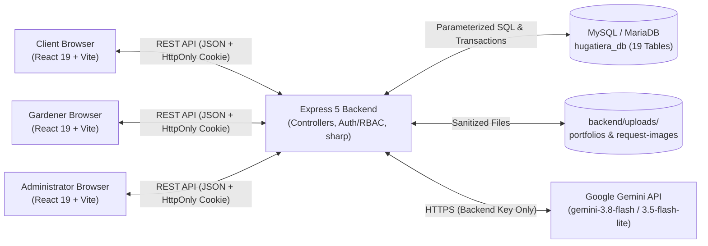
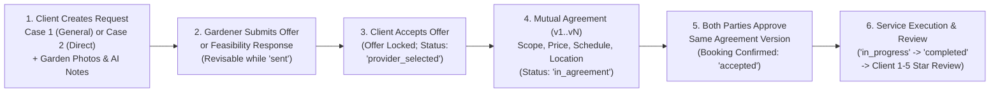

# HugaTiera — Gardening and Landscaping Services Platform

**HugaTiera** is a full-stack academic Software Engineering web platform designed initially for **Zamboanga City, Philippines**. It connects clients who need gardening, landscaping, plant care, and garden maintenance services with local gardeners who provide those services.

HugaTiera is a **services marketplace and coordination platform**, not an e-commerce store for physical gardening products. It combines structured service discovery, portfolio showcases, **AI-assisted garden requirement and photo understanding**, a **unified two-workflow request engine** (Case 1 General Service Requests and Case 2 Direct Service Provider Inquiries), **versioned mutual agreements**, booking lifecycle tracking, in-app messaging, ratings and reviews, and administrator moderation.

---

## 1. Main Problems Addressed

1. **Fragmented Local Gardener Discovery:** Clients in Zamboanga City often rely on informal word-of-mouth to find reliable gardeners without clear visibility into service areas, experience, portfolios, or verified reviews.
2. **Unclear Garden Service Requirements:** Clients frequently struggle to articulate garden dimensions, sunlight/drainage conditions, and scope of work before requesting quotes.
3. **Lack of Structured Agreement Before Service Confirmation:** Informal chat arrangements often lead to misunderstandings over scope, pricing, schedule, or location. HugaTiera enforces an explicit **versioned mutual agreement** that both client and gardener must approve before any booking is confirmed.

---

## 2. Implemented Features

- **Role-Based Authentication & Security:**
  - Client and Gardener registration with `bcryptjs` password hashing and `HttpOnly` JWT cookies (`hugatiera_token`).
  - Live account status verification (`users.is_active = TRUE`) on every protected request; administrator self-registration is blocked.
- **Public Marketplace & Gardener Portfolios:**
  - Keyword, category, and service-area filtering with sorting (`newest`, `price_low`, `price_high`) and pagination (`/services`).
  - Public visibility gated by administrator gardener approval (`gardener_profiles.is_approved = TRUE`).
  - Gardener portfolio photo uploads with magic-byte validation (`JPEG`, `PNG`, `WebP`, up to 5 MB), metadata editing, and public gallery display alongside verified star ratings (`/gardeners/:gardenerId`).
  - Automatic full-name fallback (`first_name + last_name`) whenever a gardener's `business_name` is optional/empty (`ISS-04`).
- **Secure Garden Photo Uploads (`Step R2` & `ISS-01`):**
  - Client garden photo uploads (`POST /api/request-images`) decoded, auto-oriented, resized within `1920×1920`, and re-encoded via `sharp` with **all EXIF, GPS location, XMP, and IPTC metadata stripped**.
  - Separate storage for `originals/` and future `generated/` images, scheduled + upload-triggered 24-hour draft cleanup, and authenticated delivery (`GET /api/request-images/:imageId`).
- **Unified Request Engine — Case 1 & Case 2 (`Steps R4 & R5`):**
  - **Case 1 (General Service Request):** Clients post an open request (`request_type = 'general'`) with up to 5 garden photos and an optional validity window (`7`, `14`, or `30` days). Approved gardeners browse the **Open Service Requests Board** (`GET /api/inquiries/open` with area-level privacy), submit offers, and revise or withdraw offers before client acceptance. Clients compare competing offers side by side with provider ratings, completed bookings, experience, and portfolio previews.
  - **Case 2 (Direct Service Provider Inquiry):** Clients send a direct inquiry (`request_type = 'direct'`) to a specific approved gardener or service listing. The targeted gardener evaluates feasibility and responds with `offer`, `feasible`, `modifications` (with proposed changes), or `cannot_do`.
  - **Offer Revisions & Locking:** Superseded offer revisions are preserved in `quotation_revisions`. Accepting an offer sets `locked_at = NOW()` and transitions the inquiry to `'provider_selected'`.
- **Versioned Mutual Agreement Engine (`Step R3` & `ISS-09`):**
  - Neither an inquiry, offer, nor offer acceptance automatically creates a booking (`POST /api/bookings` returns `409 MUTUAL_AGREEMENT_REQUIRED`).
  - Both Case 1 and Case 2 (plus priced-service requests via `POST /api/agreements/direct-service`) require a **Mutual Agreement** (`agreements` table) specifying `scope_of_work`, `amount`, `price_basis`, `scheduled_start`, `scheduled_end`, `location`, and `conditions`.
  - Editing a proposed agreement creates version $N+1$ (`previous_agreement_id`) and resets counterparty approval.
  - Only when **both** client and gardener approve the **same version** does the backend atomically verify schedule conflicts, mark the agreement `'agreed'`, create the confirmed booking (`status = 'accepted'`), mark the inquiry `'confirmed'`, and decline competing open offers.
  - Booking detail pages display a read-only **Mutual Agreement Summary** panel (`ISS-09`).
- **Gemini AI Garden Planning Assistant (`Step R6 / R7`):**
  - Backend-mediated integration with Google Gemini (`GEMINI_MODEL=gemini-3.8-flash` primary, `GEMINI_FALLBACK_MODEL=gemini-3.5-flash-lite` automatic fallback on transient `429`/`5xx`/timeout/network errors, `GEMINI_THINKING_LEVEL=low`).
  - Supports standalone tropical garden planning (`POST /api/ai/garden-plan`), structured inquiry requirement generation (`POST /api/ai/requirements`), and multimodal garden photo analysis (`POST /api/ai/photo-analysis`).
  - Concurrency-safe per-user rate limiting (`10` calls/hour via `SELECT ... FOR UPDATE` and `ai_usage_log`).
  - Provider Decision-Support View displays client-reviewed AI summaries and photo descriptions to evaluating gardeners.
- **Role-Specific Dashboards, Messaging, Notifications & Admin Moderation (`Phases 10–14` & `ISS-02`–`ISS-08`):**
  - Tabbed Client and Gardener dashboards (`Overview` vs `Profile & Settings` — `ISS-05`).
  - Administrator dashboard with live `open / total` inquiry and `completed / total` booking metrics (`ISS-06`), pending gardener approval queue, account activation toggles, category/service moderation, unassigned Case 1 activity monitoring (`ISS-02`), and report resolution.
  - In-app 1-to-1 conversations (gated on Case 1 until a gardener holds an active offer), unread notification routing badges, and human-readable workflow status badges (`ISS-08`).

---

## 3. Technology Stack

| Layer | Technology | Version / Details |
|---|---|---|
| **Frontend** | React.js + Vite | `react` `^19.3.1`, `vite` `^8.3.6`, JavaScript (ES Modules), HTML5, CSS3 |
| **Routing & UI** | React Router DOM + Lucide React | `react-router-dom` `^7.18.5`, `lucide-react` `^1.69.0`, `axios` `^1.21.0` |
| **Backend** | Node.js + Express.js | `express` `^5.3.0` (CommonJS REST API) |
| **Database** | MySQL / MariaDB (`InnoDB`) | `mysql2` `^3.24.6` (`mysql2/promise` connection pool & transactions), `19` tables, `46` FKs |
| **Authentication** | JWT + bcryptjs | `jsonwebtoken` `^9.0.2` (`HttpOnly` cookie), `bcryptjs` `^3.0.2`, `cookie-parser` `^1.4.7` |
| **Image Processing** | Multer + Sharp | `multer` `^2.5.0`, `sharp` `^0.35.5` (validation, resize, EXIF/GPS stripping) |
| **AI Integration** | Google Gemini REST API | Primary: `gemini-3.8-flash` \| Automatic Fallback: `gemini-3.5-flash-lite` |
| **Testing & Linting** | Node.js Test Runner + ESLint | `node --test` (`53/53` automated backend tests across 6 suites), `eslint` `^10.14.0` |

---

## 4. System Architecture & Workflow Overview



### Unified Request-to-Confirmation Workflow


---

## 5. Application Modules & Frontend Routes

| Frontend Route | Access | Component (`frontend/src/`) | Purpose |
|---|---|---|---|
| `/` | Public | `App.jsx` (`LandingPage`) | Hero section, live categories, featured approved services, workflow guide, AI preview, and auth-aware floating message button (`ISS-07`). |
| `/services` | Public | `pages/ServicesPage.jsx` | Marketplace search, category/area filter, sort, and pagination. |
| `/services/:serviceId` | Public | `pages/ServiceDetailPage.jsx` | Service details, gardener summary, direct inquiry link, priced-service agreement modal, and report form. |
| `/gardeners/:gardenerId` | Public | `pages/GardenerPage.jsx` | Approved gardener profile, active services, portfolio gallery, reviews, direct inquiry action, and report form. |
| `/login`, `/register` | Public | `pages/AuthPage.jsx` | Sign-in and Client/Gardener registration forms. |
| `/dashboard` | Protected (`client`, `gardener`, `administrator`) | `pages/DashboardPage.jsx` | Role-specific dashboard (`Overview` and `Profile & Settings` tabs for Client/Gardener; full moderation & metrics panel for Administrator). |
| `/inquiries` | Protected (`client`, `gardener`) | `pages/InquiryPage.jsx` (`InquiriesPage`) | Client request list or Gardener assigned inquiries + Open Service Requests Board tab. |
| `/inquiries/new` | Protected (`client`) | `pages/InquiryPage.jsx` (`InquiryFormPage`) | Case 1 / Case 2 request creation wizard with garden photo upload, AI photo analysis, and AI requirement assistant. |
| `/inquiries/:inquiryId` | Protected (`client`, `gardener`, `administrator`) | `pages/InquiryPage.jsx` (`InquiryDetailPage`) | Provider Decision-Support View, offer submission/revision/comparison, R3 Mutual Agreement workspace, and event timeline. |
| `/bookings` | Protected (`client`, `gardener`) | `pages/BookingPage.jsx` (`BookingsPage`) | Confirmed and historical bookings list with agreement version badges. |
| `/bookings/new` | Protected (`client`) | `pages/BookingPage.jsx` (`BookingFormPage`) | Redirects/guides users to the R3 Mutual Agreement workflow on the inquiry or service page. |
| `/bookings/:bookingId` | Protected (`client`, `gardener`) | `pages/BookingPage.jsx` (`BookingDetailPage`) | Booking execution controls, read-only **Mutual Agreement Summary** (`ISS-09`), conversation launcher, and post-completion review form. |
| `/messages` | Protected (All roles) | `pages/CommunicationPage.jsx` | 1-to-1 conversation threads and in-app notifications center with deep-link routing. |
| `/assistant` | Protected (All roles) | `pages/AssistantPage.jsx` | Standalone AI Garden Planning Assistant with quota display and safety disclaimer. |

---

## 6. Installation & Local Setup Instructions

### 6.1 Prerequisites
- **Node.js** (v20+ LTS recommended) and **npm**
- **XAMPP** (MariaDB 10.4.32 / MySQL on port `3306`)
- **Git** and **Visual Studio Code**

### 6.2 Clone and Install Dependencies
```powershell
git clone <repository-url>
cd HugaTiera

# Install backend dependencies
npm --prefix backend install

# Install frontend dependencies
npm --prefix frontend install
```

### 6.3 Environment Configuration

Create `backend/.env` (using [backend/.env.example](file:///c:/xampp/htdocs/HugaTiera/backend/.env.example) as a template):
```env
PORT=5000
FRONTEND_URL=http://localhost:5173
DB_HOST=localhost
DB_PORT=3306
DB_USER=root
DB_PASSWORD=
DB_NAME=hugatiera_db
JWT_SECRET=replace_with_a_long_random_secret_key
GEMINI_API_KEY=replace_with_your_gemini_api_key
GEMINI_MODEL=gemini-3.8-flash
GEMINI_FALLBACK_MODEL=gemini-3.5-flash-lite
GEMINI_THINKING_LEVEL=low
AI_HOURLY_LIMIT=10
```

Create `frontend/.env` (using [frontend/.env.example](file:///c:/xampp/htdocs/HugaTiera/frontend/.env.example) as a template):
```env
VITE_API_URL=http://localhost:5000/api
```

> [!WARNING]
> Never commit `backend/.env` or `frontend/.env` to Git, and never expose `GEMINI_API_KEY`, `JWT_SECRET`, or database credentials in frontend variables.

---

## 7. Database Setup & Migration 001 Status

### 7.1 Fresh Database Installation
If setting up HugaTiera on a new machine without an existing `hugatiera_db` database, start MySQL in XAMPP and import [database/schema/hugatiera_schema.sql](file:///c:/xampp/htdocs/HugaTiera/database/schema/hugatiera_schema.sql), which creates `hugatiera_db` with all **19 tables** and **46 foreign keys**:
```powershell
c:\xampp\mysql\bin\mysql.exe -u root < database/schema/hugatiera_schema.sql
```

### 7.2 Existing Database & Migration 001 Record
- On the current development/production workspace, **Migration 001 (`database/migrations/001_unified_requests_and_agreements.sql`) was executed and verified against `hugatiera_db` on November 12, 2026**.
- Both `hugatiera_db` (production database) and `hugatiera_db_migration_test` (automated test database) are at the complete 19-table schema (`46` foreign keys).
- **Do NOT rerun `001_unified_requests_and_agreements.sql` against `hugatiera_db`.**
- Full table-by-table documentation, the 19-table Mermaid ERD, and Migration 001 verification details are in [database/README.md](file:///c:/xampp/htdocs/HugaTiera/database/README.md).

---

## 8. Running & Testing the Application

### 8.1 Start the Backend and Frontend Servers
```powershell
# Terminal 1 — Start the Express backend on http://localhost:5000
npm --prefix backend run dev

# Terminal 2 — Start the Vite React frontend on http://localhost:5173
npm --prefix frontend run dev
```

Verify backend and database health at `http://localhost:5000/api/health`.

### 8.2 Frontend Lint & Production Build
```powershell
npm --prefix frontend run lint
npm --prefix frontend run build
```

### 8.3 Automated Backend Test Suites (`53/53` Tests)
All automated backend test suites run against the dedicated test database **`hugatiera_db_migration_test`** (`DB_NAME=hugatiera_db_migration_test`) so `hugatiera_db` is never modified by test runs. Run all 6 suites sequentially (`--test-concurrency=1`):
```powershell
$env:DB_NAME="hugatiera_db_migration_test"
node --test --test-concurrency=1 `
  backend/tests/integration.test.js `
  backend/tests/r2.requestImages.test.js `
  backend/tests/r3.agreements.test.js `
  backend/tests/r4.directInquiry.test.js `
  backend/tests/r5.generalRequest.test.js `
  backend/tests/r6.aiAssistance.test.js
```

| Test Suite File | Scope Covered | Passing Tests |
|---|---|---|
| `backend/tests/integration.test.js` | Core Phases 1–15 + Audit Fixes (`TC-01`–`TC-18`: auth, approval visibility, Case 1/2 inquiries, agreements, bookings, messaging, reviews, reports, deactivation, `ISS-01`–`ISS-09`) | `15 / 15` |
| `backend/tests/r2.requestImages.test.js` | Step R2 garden photo upload, `sharp` EXIF/GPS stripping, role/ownership access control, 24h draft cleanup | `12 / 12` |
| `backend/tests/r3.agreements.test.js` | Step R3 versioned mutual agreements, approval reset on edit, stale-version & duplicate rejection, `Promise.all` concurrency, booking gating | `5 / 5` |
| `backend/tests/r4.directInquiry.test.js` | Step R4 Case 2 direct inquiry, draft photo attachment, feasibility responses, offer revisions (`quotation_revisions`), withdrawal, locking, lazy expiry | `6 / 6` |
| `backend/tests/r5.generalRequest.test.js` | Step R5 Case 1 general request, open board privacy, multi-provider offer isolation, comparison metrics, Case 1 chat gating, renewal | `6 / 6` |
| `backend/tests/r6.aiAssistance.test.js` | Step R6/R7 Gemini requirements & photo analysis, primary (`gemini-3.8-flash`) to fallback (`gemini-3.5-flash-lite`) Scenarios A–H, `Promise.all` 15-request concurrency rate limit | `9 / 9` |
| **Total** | **All Automated Backend Integration & Revision Suites** | **`53 / 53`** |

---

## 9. Security, Privacy & Current Scope Boundaries

- **Photo Privacy:** Client garden photos are stripped of all EXIF/GPS metadata by `sharp` before disk storage and are never served from a public static folder. Furthermore, the Open Service Requests Board (`GET /api/inquiries/open`) exposes only area-level location and client first name; exact street addresses are shared only inside the mutual agreement.
- **SQL Injection & Access Control:** Every database query uses parameterized `mysql2` placeholders (`?`), and every protected endpoint verifies authentication, active user status, role permissions, and resource ownership.
- **Intentional Scope Exclusions (Per Academic Project Rules):**
  - No online payment processing, wallets, escrow, or financial settlement (all payments are settled directly between client and gardener outside the platform).
  - No physical gardening product e-commerce, live GPS tracking, payroll, or native mobile apps.
  - Paid AI image generation is postponed (`501 IMAGE_GENERATION_POSTPONED`); only text and uploaded-photo understanding are active.
- **Remaining Manual Verification Items:** Live Gemini generation with a real `GEMINI_API_KEY` and manual multi-device browser visual checks are tracked in [project_progress.md](file:///c:/xampp/htdocs/HugaTiera/project_progress.md).

---

## 10. Documentation Index

| Document | Description |
|---|---|
| [README.md](file:///c:/xampp/htdocs/HugaTiera/README.md) | Main project overview, setup, testing, and quick reference (this file). |
| [database/README.md](file:///c:/xampp/htdocs/HugaTiera/database/README.md) | Authoritative 19-table schema reference, 46 FKs, Mermaid ERD, and Migration 001 execution record. |
| [docs/architecture-and-workflows.md](file:///c:/xampp/htdocs/HugaTiera/docs/architecture-and-workflows.md) | System architecture, Client/Gardener/Admin workflows, Case 1 vs Case 2 + R3 Agreement flowcharts, and Gemini AI fallback design. |
| [docs/api-reference.md](file:///c:/xampp/htdocs/HugaTiera/docs/api-reference.md) | Complete REST API endpoint documentation across all 15 route modules. |
| [docs/implementation/implementation-plan.md](file:///c:/xampp/htdocs/HugaTiera/docs/implementation/implementation-plan.md) | Revision Track R0–R7 technical specification and state machine rules. |
| [project_progress.md](file:///c:/xampp/htdocs/HugaTiera/project_progress.md) | Chronological project progress tracker, completed phases/revisions, and verification records. |
| [system_bug_and_missing_features.md](file:///c:/xampp/htdocs/HugaTiera/system_bug_and_missing_features.md) | Resolved Phase 15 bugs (`BUG-01`–`BUG-07`), resolved Post-Migration Audit items (`ISS-01`–`ISS-10`), and verified scope boundaries. |
| [folder_structure.md](file:///c:/xampp/htdocs/HugaTiera/folder_structure.md) | Verified directory and file tree of the repository. |
| [backend/README.md](file:///c:/xampp/htdocs/HugaTiera/backend/README.md) | Backend-specific setup, scripts, and module summary. |
| [frontend/README.md](file:///c:/xampp/htdocs/HugaTiera/frontend/README.md) | Frontend-specific setup, scripts, and structure summary. |
