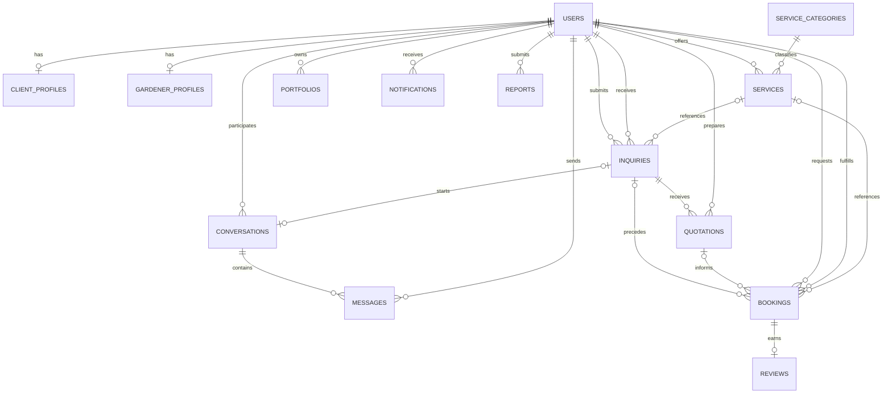

# HugaTiera Database

This directory contains the MySQL schema for the approved HugaTiera architecture.

## Initialization

1. Start MySQL through XAMPP.
2. Open MySQL Workbench or phpMyAdmin.
3. Execute `schema/hugatiera_schema.sql`.
4. Execute `seeds/service_categories.sql`.
5. Confirm that the `hugatiera_db` database and all tables were created.
6. Configure the backend connection using environment variables during Phase 3.

The schema uses InnoDB foreign keys and `utf8mb4`. The application must enforce
role ownership and workflow transitions in the backend in addition to the
database constraints.

## Core relationships

- Each user has one role and may have one client or gardener profile.
- A gardener owns many services and portfolio records.
- An inquiry belongs to a client and gardener and may reference one service.
- Quotations belong to inquiries and do not create bookings automatically.
- A client submits a separate booking request; the gardener accepts or declines it.
- Only completed bookings should be eligible for reviews.
- Conversations contain messages between a client and gardener.

## Mermaid ER diagram

## Integrity rules implemented by the backend

- `client_id`, `gardener_id`, and `sender_id` must match the relevant roles.
- A quotation must belong to the inquiry's gardener.
- A booking must remain separate from its inquiry and quotation.
- Reviews can be created only for completed bookings by the booking client.
- Booking and inquiry status transitions must be validated explicitly.
- Report targets must be checked so at least one reported entity is present.
- Portfolio uploads are stored under `backend/uploads/portfolios/` and are
  limited to JPEG, PNG, and WebP files up to 5 MB.
