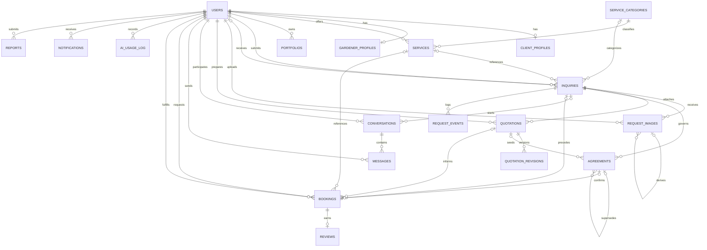

# HugaTiera Database

This directory contains the MySQL/MariaDB schema and additive migrations for the approved HugaTiera architecture.

## Initialization (Fresh Database)

1. Start MySQL/MariaDB through XAMPP.
2. Open MySQL Workbench or phpMyAdmin.
3. Execute `schema/hugatiera_schema.sql` (creates the 19-table schema).
4. Execute `seeds/service_categories.sql`.
5. Confirm that the `hugatiera_db` database and all 19 tables were created.
6. Configure the backend connection using environment variables.

## Upgrading an Existing 14-Table Database (Migration 001 – Step R1)

1. Back up the database first (into `database/backups/`, which is git-ignored).
2. Restore the backup into a separate test database (for example, `hugatiera_db_migration_test`) and rehearse the migration there before touching `hugatiera_db`.
3. Select the target database and run `migrations/001_unified_requests_and_agreements.sql` once.
4. For rollback rehearsal or structural reversion, see `migrations/001_unified_requests_and_agreements_rollback.sql` (in real usage, restore the pre-migration SQL dump because DDL statements cannot be rolled back inside a transaction in MySQL/MariaDB).

The schema uses InnoDB foreign keys and `utf8mb4`. The application enforces role ownership and workflow transitions in the backend in addition to the database constraints.

## Core relationships

- Each user has one role (`client`, `gardener`, `administrator`) and may have one client or gardener profile.
- A gardener owns many services and portfolio records.
- `inquiries` supports both **Case 1 – General Service Request** (`request_type = 'general'`, `gardener_id IS NULL`) and **Case 2 – Direct Service Provider Inquiry** (`request_type = 'direct'`, `gardener_id IS NOT NULL`), plus an optional expiration date (`expires_at`).
- `request_images` stores uploaded client garden photos (`kind = 'original'`) and keeps a self-reference (`parent_image_id`, `kind = 'ai_generated'`) ready for future AI image generation.
- `quotations` stores provider expressions of interest, offers, and feasibility responses (`response_type`), enforces at most one active offer per provider per request via a generated column (`active_flag`), and tracks prior versions in `quotation_revisions`.
- `agreements` stores versioned mutual agreements (`scope_of_work`, `amount`, `scheduled_start`, `scheduled_end`, `location`, `conditions`) with two-party approval timestamps (`client_approved_at`, `gardener_approved_at`) and enforces at most one active agreement (`proposed` or `agreed`) per request via `active_key`.
- `bookings` links to the mutually approved agreement (`agreement_id` UNIQUE FK; nullable for pre-revision historical records). Neither an inquiry, an offer, nor a client acceptance creates a booking automatically.
- `conversations` allows one thread per `(inquiry_id, gardener_id)` pair so multiple providers can communicate on an open Case 1 request (after submitting an offer).
- `request_events` records an audit log of workflow transitions and approvals; `ai_usage_log` tracks per-user AI feature usage without storing raw prompt text.
- Only completed bookings are eligible for reviews.

## Mermaid ER diagram

## Integrity rules implemented by the database and backend

- `chk_inquiries_direct_has_provider` ensures every direct inquiry specifies `gardener_id`, while general requests allow `gardener_id IS NULL`.
- `uq_quotation_active_offer (inquiry_id, gardener_id, active_flag)` ensures a provider has at most one active (`draft`, `sent`, `accepted`) offer per request while preserving `withdrawn`, `declined`, and `expired` records.
- `uq_one_active_agreement (active_key)` ensures at most one active (`proposed` or `agreed`) agreement exists per request at any time.
- `chk_agreement_agreed_needs_both`, `chk_agreement_schedule`, and `chk_agreement_proposer` enforce that an agreement can only reach `agreed` when both `client_approved_at` and `gardener_approved_at` are set, `scheduled_end > scheduled_start`, and `proposed_by` is either `client_id` or `gardener_id`.
- `uq_booking_agreement (agreement_id)` ensures one confirmed booking per approved agreement.
- Expired requests (`expires_at <= NOW()`) cannot receive new offers or revisions, whereas requests already in `provider_selected`, `in_agreement`, or `confirmed` are never auto-expired or auto-cancelled.
- Portfolio uploads are stored under `backend/uploads/portfolios/` and are limited to JPEG, PNG, and WebP files up to 5 MB; client garden photos (R2) will be stored outside the public static mount, processed with `sharp` to strip EXIF/GPS metadata, and served through an authenticated endpoint.

