# HugaTiera — Database Schema, ERD & Migration Documentation

This directory contains the authoritative relational schema, migration scripts, and database documentation for **HugaTiera**.

---

## 1. Database Overview

| Property | Value |
|---|---|
| **Production Database** | `hugatiera_db` |
| **Automated Test Database** | `hugatiera_db_migration_test` |
| **Database Engine** | MySQL 8.0.16+ / MariaDB 10.4.32 (XAMPP) — `InnoDB` |
| **Character Set & Collation** | `utf8mb4` / `utf8mb4_unicode_ci` |
| **Total Tables** | `19` |
| **Total Foreign Key Constraints** | `46` |
| **Fresh-Install Schema** | `database/schema/hugatiera_schema.sql` |
| **Migration 001 Forward Script** | `database/migrations/001_unified_requests_and_agreements.sql` |
| **Migration 001 Structural Rollback** | `database/migrations/001_unified_requests_and_agreements_rollback.sql` |
| **Local Backups Directory** | `database/backups/` (git-ignored) |

> [!CAUTION]
> **Production Migration 001 Status:** Migration 001 (`001_unified_requests_and_agreements.sql`) was **executed and verified on `hugatiera_db` on November 12, 2026**. Both `hugatiera_db` and `hugatiera_db_migration_test` are at the complete 19-table schema (`46` foreign key constraints). **Do NOT rerun `001_unified_requests_and_agreements.sql` on `hugatiera_db`.**

---

## 2. Entity Relationship Diagram (ERD)

The Mermaid Entity Relationship Diagram below represents all **19 tables** in the current `hugatiera_db` schema, including primary keys (`PK`), foreign keys (`FK`), unique keys (`UK`), and relationship cardinalities (`||` mandatory one, `|o` optional one, `o{` zero or many).

```mermaid
erDiagram
  users ||--o| client_profiles : "has client profile"
  users ||--o| gardener_profiles : "has gardener profile"
  users ||--o{ services : "gardener offers"
  service_categories ||--o{ services : "categorizes"
  users ||--o{ portfolios : "gardener uploads"

  users ||--o{ inquiries : "client submits"
  users |o--o{ inquiries : "direct target gardener"
  services |o--o{ inquiries : "optional service"
  service_categories |o--o{ inquiries : "optional category"

  inquiries |o--o{ request_images : "has attached photos"
  users ||--o{ request_images : "uploaded by"
  request_images |o--o{ request_images : "parent original image"

  inquiries ||--o{ quotations : "receives offers/responses"
  users ||--o{ quotations : "gardener submits"
  quotations ||--o{ quotation_revisions : "snapshots prior revisions"

  inquiries ||--o{ agreements : "negotiates agreement"
  quotations |o--o{ agreements : "derived from offer"
  users ||--o{ agreements : "client party"
  users ||--o{ agreements : "gardener party"
  users ||--o{ agreements : "proposed by"
  agreements |o--o| agreements : "supersedes previous version"

  agreements |o--o| bookings : "confirms arrangement"
  inquiries |o--o{ bookings : "originating request"
  quotations |o--o{ bookings : "originating offer"
  users ||--o{ bookings : "client books"
  users ||--o{ bookings : "gardener fulfills"
  services |o--o{ bookings : "booked service"

  bookings ||--o| reviews : "reviewed once after completion"
  users ||--o{ reviews : "client writes"
  users ||--o{ reviews : "gardener receives"

  inquiries |o--o{ conversations : "per-provider inquiry thread"
  users ||--o{ conversations : "client participant"
  users ||--o{ conversations : "gardener participant"
  conversations ||--o{ messages : "contains"
  users ||--o{ messages : "sender"

  inquiries ||--o{ request_events : "audit trail"
  quotations |o--o{ request_events : "related offer"
  agreements |o--o{ request_events : "related agreement"
  users |o--o{ request_events : "actor"

  users ||--o{ ai_usage_log : "consumes AI quota"
  users ||--o{ notifications : "receives"

  users ||--o{ reports : "reporter submits"
  users |o--o{ reports : "reported user"
  services |o--o{ reports : "reported service"
  messages |o--o{ reports : "reported message"
  users |o--o{ reports : "resolved by admin"

  users {
    int_unsigned id PK
    varchar email UK
    varchar password_hash
    enum role "client | gardener | administrator"
    varchar first_name
    varchar last_name
    varchar phone
    boolean is_active
    timestamp created_at
    timestamp updated_at
  }

  client_profiles {
    int_unsigned user_id PK, FK
    varchar address
    varchar city
    text bio
  }

  gardener_profiles {
    int_unsigned user_id PK, FK
    varchar business_name
    text description
    varchar service_area
    tinyint_unsigned years_of_experience
    boolean is_approved
  }

  service_categories {
    int_unsigned id PK
    varchar name UK
    text description
    boolean is_active
    timestamp created_at
  }

  services {
    int_unsigned id PK
    int_unsigned gardener_id FK
    int_unsigned category_id FK
    varchar title
    text description
    decimal indicative_price
    varchar price_unit
    varchar service_area
    boolean is_active
    timestamp created_at
    timestamp updated_at
  }

  portfolios {
    int_unsigned id PK
    int_unsigned gardener_id FK
    varchar title
    text description
    varchar image_path
    timestamp created_at
  }

  inquiries {
    int_unsigned id PK
    enum request_type "direct | general"
    int_unsigned client_id FK
    int_unsigned gardener_id FK "NULL for general requests"
    int_unsigned service_id FK
    varchar subject
    text description
    date requested_date
    varchar location
    enum status "open | responded | closed | cancelled | provider_selected | in_agreement | confirmed | expired"
    timestamp created_at
    timestamp updated_at
    int_unsigned category_id FK
    text ai_summary
    datetime expires_at
  }

  request_images {
    int_unsigned id PK
    int_unsigned inquiry_id FK "NULL while draft"
    int_unsigned uploaded_by FK
    enum kind "original | ai_generated"
    int_unsigned parent_image_id FK
    varchar file_path
    varchar mime_type
    int_unsigned file_size
    text ai_description
    timestamp created_at
  }

  quotations {
    int_unsigned id PK
    int_unsigned inquiry_id FK
    int_unsigned gardener_id FK
    decimal amount
    text details
    date availability_start
    date availability_end
    enum status "draft | sent | accepted | declined | expired | withdrawn"
    date valid_until
    timestamp created_at
    timestamp updated_at
    enum response_type "interest | offer | feasible | modifications | cannot_do"
    text proposed_changes
    int_unsigned revision_number
    timestamp locked_at
    tinyint_unsigned active_flag "GENERATED STORED"
  }

  quotation_revisions {
    int_unsigned id PK
    int_unsigned quotation_id FK
    int_unsigned revision_number
    varchar response_type
    decimal amount
    text details
    text proposed_changes
    date availability_start
    date availability_end
    date valid_until
    timestamp created_at
  }

  agreements {
    int_unsigned id PK
    int_unsigned inquiry_id FK
    int_unsigned quotation_id FK
    int_unsigned client_id FK
    int_unsigned gardener_id FK
    int_unsigned previous_agreement_id FK
    int_unsigned version
    text scope_of_work
    decimal amount
    varchar price_basis
    datetime scheduled_start
    datetime scheduled_end
    varchar location
    text conditions
    int_unsigned proposed_by FK
    timestamp client_approved_at
    timestamp gardener_approved_at
    enum status "proposed | agreed | superseded | cancelled"
    int_unsigned active_key "GENERATED STORED UK"
    timestamp created_at
    timestamp updated_at
  }

  bookings {
    int_unsigned id PK
    int_unsigned inquiry_id FK
    int_unsigned quotation_id FK
    int_unsigned client_id FK
    int_unsigned gardener_id FK
    int_unsigned service_id FK
    datetime scheduled_start
    datetime scheduled_end
    varchar location
    text notes
    enum status "pending | accepted | declined | in_progress | completed | cancelled"
    timestamp requested_at
    timestamp updated_at
    int_unsigned agreement_id FK, UK "NULL only on legacy rows"
  }

  reviews {
    int_unsigned id PK
    int_unsigned booking_id FK, UK
    int_unsigned client_id FK
    int_unsigned gardener_id FK
    tinyint_unsigned rating
    text review_text
    boolean is_visible
    timestamp created_at
  }

  conversations {
    int_unsigned id PK
    int_unsigned client_id FK
    int_unsigned gardener_id FK
    int_unsigned inquiry_id FK
    timestamp created_at
  }

  messages {
    int_unsigned id PK
    int_unsigned conversation_id FK
    int_unsigned sender_id FK
    text message_text
    timestamp sent_at
    timestamp read_at
  }

  notifications {
    int_unsigned id PK
    int_unsigned user_id FK
    varchar notification_type
    varchar title
    text message
    varchar related_entity_type
    int_unsigned related_entity_id
    timestamp read_at
    timestamp created_at
  }

  reports {
    int_unsigned id PK
    int_unsigned reporter_id FK
    int_unsigned reported_user_id FK
    int_unsigned reported_service_id FK
    int_unsigned reported_message_id FK
    varchar reason
    text details
    enum status "open | reviewing | resolved | dismissed"
    int_unsigned resolved_by FK
    text resolution_notes
    timestamp created_at
    timestamp resolved_at
  }

  request_events {
    int_unsigned id PK
    int_unsigned inquiry_id FK
    int_unsigned quotation_id FK
    int_unsigned agreement_id FK
    int_unsigned actor_id FK
    varchar event_type
    varchar from_status
    varchar to_status
    varchar note
    timestamp created_at
  }

  ai_usage_log {
    int_unsigned id PK
    int_unsigned user_id FK
    enum feature "requirements | photo_analysis | garden_plan"
    int_unsigned inquiry_id
    int_unsigned request_image_id
    varchar model
    enum outcome "success | error | rate_limited"
    varchar error_code
    timestamp created_at
  }
```

---

## 3. Complete Table-by-Table Schema Reference (19 Tables)

### 3.1 `users`
- **Purpose:** Stores core authentication credentials, role assignment, contact info, and activation state for all platform users.
- **Primary Key:** `id` (`INT UNSIGNED AUTO_INCREMENT`)
- **Unique Constraints:** `email` (`UNIQUE`)
- **Indexes:** `idx_users_role_active (role, is_active)`
- **Business Rules:**
  - Public registration (`/api/auth/register`) only permits `'client'` and `'gardener'`; `'administrator'` self-registration is rejected (`403`).
  - `requireAuth` middleware checks `is_active = TRUE` on every authenticated API request so deactivated accounts immediately lose access (`403`).

| Column | Data Type | Nullability | Default | Notes |
|---|---|---|---|---|
| `id` | `INT UNSIGNED` | `NOT NULL` | `AUTO_INCREMENT` | Primary key |
| `email` | `VARCHAR(255)` | `NOT NULL` | — | Unique login identifier |
| `password_hash` | `VARCHAR(255)` | `NOT NULL` | — | `bcryptjs` hash (`10` salt rounds) |
| `role` | `ENUM('client', 'gardener', 'administrator')` | `NOT NULL` | — | Role-based access control |
| `first_name` | `VARCHAR(100)` | `NOT NULL` | — | User's given name |
| `last_name` | `VARCHAR(100)` | `NOT NULL` | — | User's family name |
| `phone` | `VARCHAR(30)` | `NULL` | `NULL` | Optional contact phone |
| `is_active` | `BOOLEAN` (`TINYINT(1)`) | `NOT NULL` | `TRUE` (`1`) | Account active flag |
| `created_at` | `TIMESTAMP` | `NOT NULL` | `CURRENT_TIMESTAMP` | Creation timestamp |
| `updated_at` | `TIMESTAMP` | `NOT NULL` | `CURRENT_TIMESTAMP ON UPDATE CURRENT_TIMESTAMP` | Last update timestamp |

---

### 3.2 `client_profiles`
- **Purpose:** Stores extended profile attributes specific to users with `role = 'client'`.
- **Primary Key:** `user_id` (`INT UNSIGNED`)
- **Foreign Keys:**
  - `user_id` → `users(id)` `ON DELETE CASCADE` (1:1 relationship with `users`)

| Column | Data Type | Nullability | Default | Notes |
|---|---|---|---|---|
| `user_id` | `INT UNSIGNED` | `NOT NULL` | — | PK & FK to `users.id` |
| `address` | `VARCHAR(255)` | `NULL` | `NULL` | Client street/barangay address |
| `city` | `VARCHAR(100)` | `NOT NULL` | `'Zamboanga City'` | Default city |
| `bio` | `TEXT` | `NULL` | `NULL` | Optional garden/client notes |

---

### 3.3 `gardener_profiles`
- **Purpose:** Stores professional details, service area, experience, and administrator approval state for users with `role = 'gardener'`.
- **Primary Key:** `user_id` (`INT UNSIGNED`)
- **Foreign Keys:**
  - `user_id` → `users(id)` `ON DELETE CASCADE` (1:1 relationship with `users`)
- **Indexes:** `idx_gardener_profiles_approved_area (is_approved, service_area)`
- **Business Rules:**
  - New gardeners default to `is_approved = FALSE`.
  - Unapproved gardeners cannot appear in public `/api/services` searches, cannot view the Open Service Requests Board (`GET /api/inquiries/open`), and cannot receive or respond to inquiries.
  - Because `business_name` is nullable, all backend queries and frontend views fall back to `CONCAT(u.first_name, ' ', u.last_name)` when `business_name` is `NULL` or blank (`COALESCE(NULLIF(TRIM(gp.business_name), ''), CONCAT(u.first_name, ' ', u.last_name))`).

| Column | Data Type | Nullability | Default | Notes |
|---|---|---|---|---|
| `user_id` | `INT UNSIGNED` | `NOT NULL` | — | PK & FK to `users.id` |
| `business_name` | `VARCHAR(150)` | `NULL` | `NULL` | Optional trade/business name |
| `description` | `TEXT` | `NULL` | `NULL` | Gardener bio and specialties |
| `service_area` | `VARCHAR(150)` | `NOT NULL` | `'Zamboanga City'` | Primary coverage area |
| `years_of_experience` | `TINYINT UNSIGNED` | `NULL` | `NULL` | `0`–`80` years validated by API |
| `is_approved` | `BOOLEAN` (`TINYINT(1)`) | `NOT NULL` | `FALSE` (`0`) | Set by administrator moderation |

---

### 3.4 `service_categories`
- **Purpose:** Lookup table of gardening and landscaping service categories managed by administrators.
- **Primary Key:** `id` (`INT UNSIGNED AUTO_INCREMENT`)
- **Unique Constraints:** `name` (`UNIQUE`)
- **Business Rules:** Public service listings and request category selectors only expose categories where `is_active = TRUE`.

| Column | Data Type | Nullability | Default | Notes |
|---|---|---|---|---|
| `id` | `INT UNSIGNED` | `NOT NULL` | `AUTO_INCREMENT` | Primary key |
| `name` | `VARCHAR(100)` | `NOT NULL` | — | Unique category title |
| `description` | `TEXT` | `NULL` | `NULL` | Optional category description |
| `is_active` | `BOOLEAN` (`TINYINT(1)`) | `NOT NULL` | `TRUE` (`1`) | Active visibility toggle |
| `created_at` | `TIMESTAMP` | `NOT NULL` | `CURRENT_TIMESTAMP` | Creation timestamp |

---

### 3.5 `services`
- **Purpose:** Gardener-created gardening and landscaping service listings displayed in the public marketplace.
- **Primary Key:** `id` (`INT UNSIGNED AUTO_INCREMENT`)
- **Foreign Keys:**
  - `gardener_id` → `users(id)` `ON DELETE CASCADE`
  - `category_id` → `service_categories(id)` `ON DELETE RESTRICT`
- **Indexes:**
  - `idx_services_search (category_id, service_area, is_active)`
  - `idx_services_gardener (gardener_id, is_active)`
- **Business Rules:**
  - Public visibility requires all four conditions: `services.is_active = TRUE`, `users.is_active = TRUE`, `gardener_profiles.is_approved = TRUE`, and `service_categories.is_active = TRUE`.
  - Services with a positive `indicative_price` support the priced-service direct agreement flow (`POST /api/agreements/direct-service`).

| Column | Data Type | Nullability | Default | Notes |
|---|---|---|---|---|
| `id` | `INT UNSIGNED` | `NOT NULL` | `AUTO_INCREMENT` | Primary key |
| `gardener_id` | `INT UNSIGNED` | `NOT NULL` | — | FK to owning gardener (`users.id`) |
| `category_id` | `INT UNSIGNED` | `NOT NULL` | — | FK to `service_categories.id` |
| `title` | `VARCHAR(150)` | `NOT NULL` | — | Service listing title |
| `description` | `TEXT` | `NOT NULL` | — | Scope and service details |
| `indicative_price` | `DECIMAL(10, 2)` | `NULL` | `NULL` | Optional starting/reference price |
| `price_unit` | `VARCHAR(50)` | `NULL` | `NULL` | e.g., `per visit`, `per sq.m.` |
| `service_area` | `VARCHAR(150)` | `NOT NULL` | `'Zamboanga City'` | Area served |
| `is_active` | `BOOLEAN` (`TINYINT(1)`) | `NOT NULL` | `TRUE` (`1`) | Soft-delete / moderation flag |
| `created_at` | `TIMESTAMP` | `NOT NULL` | `CURRENT_TIMESTAMP` | Creation timestamp |
| `updated_at` | `TIMESTAMP` | `NOT NULL` | `CURRENT_TIMESTAMP ON UPDATE CURRENT_TIMESTAMP` | Last update timestamp |

---

### 3.6 `portfolios`
- **Purpose:** Gardener portfolio project showcase entries with uploaded project photos.
- **Primary Key:** `id` (`INT UNSIGNED AUTO_INCREMENT`)
- **Foreign Keys:**
  - `gardener_id` → `users(id)` `ON DELETE CASCADE`
- **Indexes:** `idx_portfolios_gardener (gardener_id, created_at)`
- **Business Rules:** Uploaded portfolio images are stored under `backend/uploads/portfolios/` and served publicly via `GET /api/portfolios/:portfolioId/image` with magic-byte validation (`JPEG`, `PNG`, `WebP`).

| Column | Data Type | Nullability | Default | Notes |
|---|---|---|---|---|
| `id` | `INT UNSIGNED` | `NOT NULL` | `AUTO_INCREMENT` | Primary key |
| `gardener_id` | `INT UNSIGNED` | `NOT NULL` | — | FK to `users.id` |
| `title` | `VARCHAR(150)` | `NOT NULL` | — | Portfolio item title |
| `description` | `TEXT` | `NULL` | `NULL` | Project description |
| `image_path` | `VARCHAR(500)` | `NOT NULL` | — | Filename inside `uploads/portfolios/` |
| `created_at` | `TIMESTAMP` | `NOT NULL` | `CURRENT_TIMESTAMP` | Upload timestamp |

---

### 3.7 `inquiries`
- **Purpose:** Unified request engine table storing both **Case 1 General Service Requests** (`request_type = 'general'`) and **Case 2 Direct Service Provider Inquiries** (`request_type = 'direct'`).
- **Primary Key:** `id` (`INT UNSIGNED AUTO_INCREMENT`)
- **Foreign Keys:**
  - `client_id` → `users(id)` `ON DELETE RESTRICT`
  - `gardener_id` → `users(id)` `ON DELETE RESTRICT`
  - `service_id` → `services(id)` `ON DELETE SET NULL`
  - `category_id` (`fk_inquiries_category`) → `service_categories(id)` `ON DELETE SET NULL`
- **CHECK Constraints:**
  - `chk_inquiries_direct_has_provider`: `CHECK (request_type = 'general' OR gardener_id IS NOT NULL)`
- **Indexes:**
  - `idx_inquiries_client_status (client_id, status, created_at)`
  - `idx_inquiries_gardener_status (gardener_id, status, created_at)`
  - `idx_inquiries_open_board (request_type, status, category_id, expires_at)`
  - `idx_inquiries_expiry (status, expires_at)`
- **Business Rules:**
  - **Case 1 (`request_type = 'general'`):** Starts with `gardener_id = NULL` and `service_id = NULL`. Once a client accepts an offer, `gardener_id` is set to the selected gardener and `status` becomes `'provider_selected'`. If that offer is later declined before an agreement is active, `gardener_id` resets to `NULL` and `status` returns to `'responded'` or `'open'`.
  - **Case 2 (`request_type = 'direct'`):** Requires `gardener_id IS NOT NULL` at creation time (enforced by both API validation and `chk_inquiries_direct_has_provider`).
  - **Lazy Expiry:** Inquiries in `'open'` or `'responded'` status with `expires_at <= NOW()` automatically transition to `'expired'` when accessed. Inquiries in `'provider_selected'`, `'in_agreement'`, or `'confirmed'` never auto-expire.

| Column | Data Type | Nullability | Default | Notes |
|---|---|---|---|---|
| `id` | `INT UNSIGNED` | `NOT NULL` | `AUTO_INCREMENT` | Primary key |
| `request_type` | `ENUM('direct', 'general')` | `NOT NULL` | `'direct'` | Added in Migration 001 |
| `client_id` | `INT UNSIGNED` | `NOT NULL` | — | FK to requesting client (`users.id`) |
| `gardener_id` | `INT UNSIGNED` | `NULL` | `NULL` | FK to provider (`NULL` for unassigned Case 1) |
| `service_id` | `INT UNSIGNED` | `NULL` | `NULL` | Optional FK to `services.id` (Case 2) |
| `subject` | `VARCHAR(200)` | `NOT NULL` | — | Request summary title |
| `description` | `TEXT` | `NOT NULL` | — | Detailed client requirements |
| `requested_date` | `DATE` | `NULL` | `NULL` | Preferred target date |
| `location` | `VARCHAR(255)` | `NULL` | `NULL` | Area/barangay location |
| `status` | `ENUM('open', 'responded', 'closed', 'cancelled', 'provider_selected', 'in_agreement', 'confirmed', 'expired')` | `NOT NULL` | `'open'` | Extended in Migration 001 |
| `created_at` | `TIMESTAMP` | `NOT NULL` | `CURRENT_TIMESTAMP` | Creation timestamp |
| `updated_at` | `TIMESTAMP` | `NOT NULL` | `CURRENT_TIMESTAMP ON UPDATE CURRENT_TIMESTAMP` | Last update timestamp |
| `category_id` | `INT UNSIGNED` | `NULL` | `NULL` | Optional FK to `service_categories.id` |
| `ai_summary` | `TEXT` | `NULL` | `NULL` | Client-reviewed AI requirement summary |
| `expires_at` | `DATETIME` | `NULL` | `NULL` | Expiration timestamp (`NULL` = never expires) |

---

### 3.8 `request_images`
- **Purpose:** Stores metadata and file paths for client-uploaded garden photos (`kind = 'original'`) and future AI-generated concept images (`kind = 'ai_generated'`), plus client-reviewed AI photo descriptions.
- **Primary Key:** `id` (`INT UNSIGNED AUTO_INCREMENT`)
- **Foreign Keys:**
  - `inquiry_id` → `inquiries(id)` `ON DELETE CASCADE`
  - `uploaded_by` → `users(id)` `ON DELETE RESTRICT`
  - `parent_image_id` → `request_images(id)` `ON DELETE SET NULL`
- **Indexes:**
  - `idx_request_images_inquiry (inquiry_id, kind)`
  - `idx_request_images_unattached (inquiry_id, created_at)`
- **Business Rules:**
  - Created in Migration 001 (Step R2).
  - Every upload is decoded and re-encoded via `sharp` (auto-oriented, fit within `1920×1920`, all EXIF/GPS/XMP/IPTC metadata stripped).
  - Uploaded draft photos start with `inquiry_id = NULL` and are attached transactionally when the client submits the inquiry (max `5` original photos per inquiry). Unattached drafts older than `24` hours are automatically purged by the scheduled cleanup job.
  - Files are never served statically; `GET /api/request-images/:imageId` enforces strict role and ownership checks.

| Column | Data Type | Nullability | Default | Notes |
|---|---|---|---|---|
| `id` | `INT UNSIGNED` | `NOT NULL` | `AUTO_INCREMENT` | Primary key |
| `inquiry_id` | `INT UNSIGNED` | `NULL` | `NULL` | FK to `inquiries.id` (`NULL` until attached) |
| `uploaded_by` | `INT UNSIGNED` | `NOT NULL` | — | FK to uploading client (`users.id`) |
| `kind` | `ENUM('original', 'ai_generated')` | `NOT NULL` | `'original'` | Separates originals from future generated images |
| `parent_image_id` | `INT UNSIGNED` | `NULL` | `NULL` | Self-FK for future generated images |
| `file_path` | `VARCHAR(500)` | `NOT NULL` | — | Relative path under `uploads/request-images/` |
| `mime_type` | `VARCHAR(50)` | `NOT NULL` | — | `image/jpeg`, `image/png`, or `image/webp` |
| `file_size` | `INT UNSIGNED` | `NOT NULL` | — | Sanitized byte size on disk |
| `ai_description` | `TEXT` | `NULL` | `NULL` | AI or client-edited garden space description |
| `created_at` | `TIMESTAMP` | `NOT NULL` | `CURRENT_TIMESTAMP` | Upload timestamp |

---

### 3.9 `quotations`
- **Purpose:** Stores gardener offers (Case 1) and feasibility/quotation responses (Case 2), including revision tracking, offer locking, and active-offer uniqueness.
- **Primary Key:** `id` (`INT UNSIGNED AUTO_INCREMENT`)
- **Foreign Keys:**
  - `inquiry_id` → `inquiries(id)` `ON DELETE CASCADE`
  - `gardener_id` → `users(id)` `ON DELETE RESTRICT`
- **Unique Constraints:**
  - `uq_quotation_active_offer (inquiry_id, gardener_id, active_flag)`
- **Indexes:**
  - `idx_quotations_inquiry (inquiry_id, created_at)`
  - `idx_quotations_gardener_status (gardener_id, status)`
- **Business Rules:**
  - `active_flag` is a stored generated column (`IF(status IN ('draft','sent','accepted'), 1, NULL)`). Because `NULL` values do not conflict in SQL `UNIQUE` indexes, a gardener may have at most **one** active (`draft`, `sent`, or `accepted`) offer per inquiry while preserving unlimited `'withdrawn'` or `'declined'` historical rows.
  - A gardener may revise (`PUT /api/inquiries/quotations/:quotationId`) or withdraw (`POST /api/inquiries/quotations/:quotationId/withdraw`) an offer only while `status = 'sent'` and `locked_at IS NULL`.
  - When a client accepts an offer, `status` becomes `'accepted'` and `locked_at` is set to `NOW()`, locking the offer against further unilateral edits.
  - Responses with `response_type = 'cannot_do'` allow `amount = NULL` and cannot be accepted by the client (`409`).

| Column | Data Type | Nullability | Default / Expression | Notes |
|---|---|---|---|---|
| `id` | `INT UNSIGNED` | `NOT NULL` | `AUTO_INCREMENT` | Primary key |
| `inquiry_id` | `INT UNSIGNED` | `NOT NULL` | — | FK to `inquiries.id` |
| `gardener_id` | `INT UNSIGNED` | `NOT NULL` | — | FK to responding gardener (`users.id`) |
| `amount` | `DECIMAL(10, 2)` | `NULL` | `NULL` | Indicative price (`NULL` allowed for `interest`/`cannot_do`) |
| `details` | `TEXT` | `NOT NULL` | — | Scope/feasibility explanation |
| `availability_start` | `DATE` | `NULL` | `NULL` | Earliest available date |
| `availability_end` | `DATE` | `NULL` | `NULL` | Latest available date |
| `status` | `ENUM('draft', 'sent', 'accepted', 'declined', 'expired', 'withdrawn')` | `NOT NULL` | `'draft'` | Extended in Migration 001 |
| `valid_until` | `DATE` | `NULL` | `NULL` | Offer validity date |
| `created_at` | `TIMESTAMP` | `NOT NULL` | `CURRENT_TIMESTAMP` | Creation timestamp |
| `updated_at` | `TIMESTAMP` | `NOT NULL` | `CURRENT_TIMESTAMP ON UPDATE CURRENT_TIMESTAMP` | Last update timestamp |
| `response_type` | `ENUM('interest', 'offer', 'feasible', 'modifications', 'cannot_do')` | `NOT NULL` | `'offer'` | Added in Migration 001 |
| `proposed_changes` | `TEXT` | `NULL` | `NULL` | Required when `response_type = 'modifications'` |
| `revision_number` | `INT UNSIGNED` | `NOT NULL` | `1` | Increments on each revision |
| `locked_at` | `TIMESTAMP` | `NULL` | `NULL` | Set when accepted by client |
| `active_flag` | `TINYINT UNSIGNED` | `NULL` | `GENERATED ALWAYS AS (IF(status IN ('draft','sent','accepted'), 1, NULL)) STORED` | Enforces 1 active offer per provider per inquiry |

---

### 3.10 `quotation_revisions`
- **Purpose:** Immutable audit snapshot table storing each superseded revision of a quotation whenever a gardener revises an unaccepted offer.
- **Primary Key:** `id` (`INT UNSIGNED AUTO_INCREMENT`)
- **Foreign Keys:**
  - `quotation_id` → `quotations(id)` `ON DELETE CASCADE`
- **Unique Constraints:** `uq_quotation_revision (quotation_id, revision_number)`

| Column | Data Type | Nullability | Default | Notes |
|---|---|---|---|---|
| `id` | `INT UNSIGNED` | `NOT NULL` | `AUTO_INCREMENT` | Primary key |
| `quotation_id` | `INT UNSIGNED` | `NOT NULL` | — | FK to `quotations.id` |
| `revision_number` | `INT UNSIGNED` | `NOT NULL` | — | Snapshot revision number (`1, 2, ...`) |
| `response_type` | `VARCHAR(20)` | `NOT NULL` | — | Prior `response_type` |
| `amount` | `DECIMAL(10, 2)` | `NULL` | `NULL` | Prior amount |
| `details` | `TEXT` | `NOT NULL` | — | Prior details |
| `proposed_changes` | `TEXT` | `NULL` | `NULL` | Prior proposed changes |
| `availability_start` | `DATE` | `NULL` | `NULL` | Prior availability start |
| `availability_end` | `DATE` | `NULL` | `NULL` | Prior availability end |
| `valid_until` | `DATE` | `NULL` | `NULL` | Prior validity date |
| `created_at` | `TIMESTAMP` | `NOT NULL` | `CURRENT_TIMESTAMP` | Snapshot timestamp |

---

### 3.11 `agreements`
- **Purpose:** Stores versioned mutual agreements between client and gardener covering scope of work, final agreed amount, price basis, schedule, exact location, and conditions. **A confirmed booking can only be created when both parties approve the exact same agreement version.**
- **Primary Key:** `id` (`INT UNSIGNED AUTO_INCREMENT`)
- **Foreign Keys:**
  - `inquiry_id` → `inquiries(id)` `ON DELETE RESTRICT`
  - `quotation_id` → `quotations(id)` `ON DELETE SET NULL`
  - `client_id` → `users(id)` `ON DELETE RESTRICT`
  - `gardener_id` → `users(id)` `ON DELETE RESTRICT`
  - `previous_agreement_id` → `agreements(id)` `ON DELETE SET NULL`
  - `proposed_by` → `users(id)` `ON DELETE RESTRICT`
- **CHECK Constraints:**
  - `chk_agreement_agreed_needs_both`: `CHECK (status <> 'agreed' OR (client_approved_at IS NOT NULL AND gardener_approved_at IS NOT NULL))`
  - `chk_agreement_schedule`: `CHECK (scheduled_end > scheduled_start)`
  - `chk_agreement_proposer`: `CHECK (proposed_by IN (client_id, gardener_id))`
- **Unique Constraints:**
  - `uq_one_active_agreement (active_key)`
- **Indexes:**
  - `idx_agreements_inquiry (inquiry_id, version)`
- **Business Rules:**
  - `active_key` is a stored generated column (`IF(status IN ('proposed', 'agreed'), inquiry_id, NULL)`), guaranteeing at the database level that an inquiry can have at most **one** active (`proposed` or `agreed`) agreement at a time.
  - Editing a proposed agreement marks version $N$ as `'superseded'`, inserts version $N+1$ linked via `previous_agreement_id`, clears the counterparty's approval (`NULL`), and records only the editor's approval timestamp.
  - When the second party approves the current version (`POST /api/agreements/:agreementId/approve`), the backend verifies schedule conflicts, transitions `status` to `'agreed'`, inserts the confirmed `bookings` record (`status = 'accepted'`), updates `inquiries.status = 'confirmed'`, and declines any competing open offers in a single atomic transaction.

| Column | Data Type | Nullability | Default / Expression | Notes |
|---|---|---|---|---|
| `id` | `INT UNSIGNED` | `NOT NULL` | `AUTO_INCREMENT` | Primary key |
| `inquiry_id` | `INT UNSIGNED` | `NOT NULL` | — | FK to `inquiries.id` |
| `quotation_id` | `INT UNSIGNED` | `NULL` | `NULL` | Optional FK to `quotations.id` (`NULL` for priced-service flow) |
| `client_id` | `INT UNSIGNED` | `NOT NULL` | — | FK to client (`users.id`) |
| `gardener_id` | `INT UNSIGNED` | `NOT NULL` | — | FK to gardener (`users.id`) |
| `previous_agreement_id` | `INT UNSIGNED` | `NULL` | `NULL` | Self-FK to superseded agreement row |
| `version` | `INT UNSIGNED` | `NOT NULL` | `1` | Version number (`1, 2, ...`) |
| `scope_of_work` | `TEXT` | `NOT NULL` | — | Mutually agreed scope of work |
| `amount` | `DECIMAL(10, 2)` | `NOT NULL` | — | Final agreed price (`> 0`) |
| `price_basis` | `VARCHAR(100)` | `NULL` | `NULL` | e.g., `Fixed project fee`, `Per visit` |
| `scheduled_start` | `DATETIME` | `NOT NULL` | — | Agreed start date/time |
| `scheduled_end` | `DATETIME` | `NOT NULL` | — | Agreed end date/time (`> scheduled_start`) |
| `location` | `VARCHAR(255)` | `NOT NULL` | — | Full service address |
| `conditions` | `TEXT` | `NULL` | `NULL` | Special conditions, materials, access notes |
| `proposed_by` | `INT UNSIGNED` | `NOT NULL` | — | FK to proposer (`client_id` or `gardener_id`) |
| `client_approved_at` | `TIMESTAMP` | `NULL` | `NULL` | Timestamp of client approval |
| `gardener_approved_at` | `TIMESTAMP` | `NULL` | `NULL` | Timestamp of gardener approval |
| `status` | `ENUM('proposed', 'agreed', 'superseded', 'cancelled')` | `NOT NULL` | `'proposed'` | Agreement lifecycle state |
| `active_key` | `INT UNSIGNED` | `NULL` | `GENERATED ALWAYS AS (IF(status IN ('proposed','agreed'), inquiry_id, NULL)) STORED` | Enforces 1 active agreement per inquiry |
| `created_at` | `TIMESTAMP` | `NOT NULL` | `CURRENT_TIMESTAMP` | Creation timestamp |
| `updated_at` | `TIMESTAMP` | `NOT NULL` | `CURRENT_TIMESTAMP ON UPDATE CURRENT_TIMESTAMP` | Last update timestamp |

---

### 3.12 `bookings`
- **Purpose:** Stores confirmed service arrangements and tracks service execution progress (`accepted` → `in_progress` → `completed` or `cancelled`).
- **Primary Key:** `id` (`INT UNSIGNED AUTO_INCREMENT`)
- **Foreign Keys:**
  - `inquiry_id` → `inquiries(id)` `ON DELETE SET NULL`
  - `quotation_id` → `quotations(id)` `ON DELETE SET NULL`
  - `client_id` → `users(id)` `ON DELETE RESTRICT`
  - `gardener_id` → `users(id)` `ON DELETE RESTRICT`
  - `service_id` → `services(id)` `ON DELETE SET NULL`
  - `agreement_id` (`fk_bookings_agreement`) → `agreements(id)` `ON DELETE RESTRICT`
- **Unique Constraints:**
  - `uq_booking_agreement (agreement_id)`
- **Indexes:**
  - `idx_bookings_client_status (client_id, status, requested_at)`
  - `idx_bookings_gardener_status (gardener_id, status, requested_at)`
  - `idx_bookings_schedule (gardener_id, scheduled_start, scheduled_end)`
- **Business Rules:**
  - Direct creation via `POST /api/bookings` is retired (`409 MUTUAL_AGREEMENT_REQUIRED`). Every new booking is created automatically by the second approval on `POST /api/agreements/:agreementId/approve` with `status = 'accepted'` and `agreement_id` populated.
  - Legacy pre-R3 bookings retain `agreement_id = NULL` and remain readable and manageable (`GET /api/bookings/:bookingId` returns `agreement_id: null` and the frontend displays a legacy-booking note).

| Column | Data Type | Nullability | Default | Notes |
|---|---|---|---|---|
| `id` | `INT UNSIGNED` | `NOT NULL` | `AUTO_INCREMENT` | Primary key |
| `inquiry_id` | `INT UNSIGNED` | `NULL` | `NULL` | FK to `inquiries.id` |
| `quotation_id` | `INT UNSIGNED` | `NULL` | `NULL` | FK to `quotations.id` |
| `client_id` | `INT UNSIGNED` | `NOT NULL` | — | FK to client (`users.id`) |
| `gardener_id` | `INT UNSIGNED` | `NOT NULL` | — | FK to gardener (`users.id`) |
| `service_id` | `INT UNSIGNED` | `NULL` | `NULL` | Optional FK to `services.id` |
| `scheduled_start` | `DATETIME` | `NULL` | `NULL` | Confirmed start date/time |
| `scheduled_end` | `DATETIME` | `NULL` | `NULL` | Confirmed end date/time |
| `location` | `VARCHAR(255)` | `NULL` | `NULL` | Service location |
| `notes` | `TEXT` | `NULL` | `NULL` | Scope/notes copied from agreement |
| `status` | `ENUM('pending', 'accepted', 'declined', 'in_progress', 'completed', 'cancelled')` | `NOT NULL` | `'pending'` | New bookings start at `'accepted'` |
| `requested_at` | `TIMESTAMP` | `NOT NULL` | `CURRENT_TIMESTAMP` | Creation timestamp |
| `updated_at` | `TIMESTAMP` | `NOT NULL` | `CURRENT_TIMESTAMP ON UPDATE CURRENT_TIMESTAMP` | Last update timestamp |
| `agreement_id` | `INT UNSIGNED` | `NULL` | `NULL` | Unique FK to `agreements.id` (`NULL` only on legacy rows) |

---

### 3.13 `reviews`
- **Purpose:** Stores client ratings (`1`–`5`) and written reviews for completed bookings.
- **Primary Key:** `id` (`INT UNSIGNED AUTO_INCREMENT`)
- **Foreign Keys:**
  - `booking_id` → `bookings(id)` `ON DELETE RESTRICT`
  - `client_id` → `users(id)` `ON DELETE RESTRICT`
  - `gardener_id` → `users(id)` `ON DELETE RESTRICT`
- **Unique Constraints:**
  - `uq_review_booking (booking_id)` (enforces at most one review per booking)
- **Indexes:**
  - `idx_reviews_gardener (gardener_id, is_visible, created_at)`
- **Business Rules:** Only the `client_id` who owns a booking with `status = 'completed'` can submit a review (`POST /api/reviews`).

| Column | Data Type | Nullability | Default | Notes |
|---|---|---|---|---|
| `id` | `INT UNSIGNED` | `NOT NULL` | `AUTO_INCREMENT` | Primary key |
| `booking_id` | `INT UNSIGNED` | `NOT NULL` | — | Unique FK to `bookings.id` |
| `client_id` | `INT UNSIGNED` | `NOT NULL` | — | FK to reviewing client (`users.id`) |
| `gardener_id` | `INT UNSIGNED` | `NOT NULL` | — | FK to reviewed gardener (`users.id`) |
| `rating` | `TINYINT UNSIGNED` | `NOT NULL` | — | Integer `1` to `5` |
| `review_text` | `TEXT` | `NULL` | `NULL` | Optional written feedback |
| `is_visible` | `BOOLEAN` (`TINYINT(1)`) | `NOT NULL` | `TRUE` (`1`) | Public visibility flag |
| `created_at` | `TIMESTAMP` | `NOT NULL` | `CURRENT_TIMESTAMP` | Submission timestamp |

---

### 3.14 `conversations`
- **Purpose:** Represents a 1-to-1 messaging thread between a client and a gardener, optionally tied to a specific inquiry.
- **Primary Key:** `id` (`INT UNSIGNED AUTO_INCREMENT`)
- **Foreign Keys:**
  - `client_id` → `users(id)` `ON DELETE RESTRICT`
  - `gardener_id` → `users(id)` `ON DELETE RESTRICT`
  - `inquiry_id` → `inquiries(id)` `ON DELETE SET NULL`
- **Unique Constraints:**
  - `uq_conversation_inquiry_provider (inquiry_id, gardener_id)` (updated in Migration 001 from single-column `uq_conversation_inquiry` so multiple gardeners who submit offers on a Case 1 general request can each have their own isolated conversation thread with the client).
- **Indexes:**
  - `idx_conversations_client (client_id)`
  - `idx_conversations_gardener (gardener_id)`
- **Business Rules:** On a Case 1 general request, a gardener may create or send messages in a conversation thread only while holding an active (`sent` or `accepted`) offer on that inquiry (`403` otherwise).

| Column | Data Type | Nullability | Default | Notes |
|---|---|---|---|---|
| `id` | `INT UNSIGNED` | `NOT NULL` | `AUTO_INCREMENT` | Primary key |
| `client_id` | `INT UNSIGNED` | `NOT NULL` | — | FK to client (`users.id`) |
| `gardener_id` | `INT UNSIGNED` | `NOT NULL` | — | FK to gardener (`users.id`) |
| `inquiry_id` | `INT UNSIGNED` | `NULL` | `NULL` | Optional FK to `inquiries.id` |
| `created_at` | `TIMESTAMP` | `NOT NULL` | `CURRENT_TIMESTAMP` | Creation timestamp |

---

### 3.15 `messages`
- **Purpose:** Stores individual chat messages within a conversation thread.
- **Primary Key:** `id` (`INT UNSIGNED AUTO_INCREMENT`)
- **Foreign Keys:**
  - `conversation_id` → `conversations(id)` `ON DELETE CASCADE`
  - `sender_id` → `users(id)` `ON DELETE RESTRICT`
- **Indexes:**
  - `idx_messages_conversation (conversation_id, sent_at)`

| Column | Data Type | Nullability | Default | Notes |
|---|---|---|---|---|
| `id` | `INT UNSIGNED` | `NOT NULL` | `AUTO_INCREMENT` | Primary key |
| `conversation_id` | `INT UNSIGNED` | `NOT NULL` | — | FK to `conversations.id` |
| `sender_id` | `INT UNSIGNED` | `NOT NULL` | — | FK to sender (`users.id`) |
| `message_text` | `TEXT` | `NOT NULL` | — | Message body (`1`–`2000` chars) |
| `sent_at` | `TIMESTAMP` | `NOT NULL` | `CURRENT_TIMESTAMP` | Sent timestamp |
| `read_at` | `TIMESTAMP` | `NULL` | `NULL` | Marked when recipient opens thread |

---

### 3.16 `notifications`
- **Purpose:** Stores in-app workflow notifications for clients, gardeners, and administrators.
- **Primary Key:** `id` (`INT UNSIGNED AUTO_INCREMENT`)
- **Foreign Keys:**
  - `user_id` → `users(id)` `ON DELETE CASCADE`
- **Indexes:**
  - `idx_notifications_user_read (user_id, read_at, created_at)`

| Column | Data Type | Nullability | Default | Notes |
|---|---|---|---|---|
| `id` | `INT UNSIGNED` | `NOT NULL` | `AUTO_INCREMENT` | Primary key |
| `user_id` | `INT UNSIGNED` | `NOT NULL` | — | FK to recipient (`users.id`) |
| `notification_type` | `VARCHAR(50)` | `NOT NULL` | — | e.g., `inquiry`, `quotation`, `agreement`, `booking`, `message`, `review`, `gardener_profile` |
| `title` | `VARCHAR(150)` | `NOT NULL` | — | Short notification heading |
| `message` | `TEXT` | `NOT NULL` | — | Notification body |
| `related_entity_type` | `VARCHAR(50)` | `NULL` | `NULL` | e.g., `inquiry`, `booking`, `conversation`, `review`, `gardener_profile` |
| `related_entity_id` | `INT UNSIGNED` | `NULL` | `NULL` | Target entity ID for frontend navigation |
| `read_at` | `TIMESTAMP` | `NULL` | `NULL` | `NULL` while unread |
| `created_at` | `TIMESTAMP` | `NOT NULL` | `CURRENT_TIMESTAMP` | Creation timestamp |

---

### 3.17 `reports`
- **Purpose:** Stores user-submitted moderation reports concerning users, services, or messages, and tracks administrator resolution.
- **Primary Key:** `id` (`INT UNSIGNED AUTO_INCREMENT`)
- **Foreign Keys:**
  - `reporter_id` → `users(id)` `ON DELETE RESTRICT`
  - `reported_user_id` → `users(id)` `ON DELETE SET NULL`
  - `reported_service_id` → `services(id)` `ON DELETE SET NULL`
  - `reported_message_id` → `messages(id)` `ON DELETE SET NULL`
  - `resolved_by` → `users(id)` `ON DELETE SET NULL`
- **Indexes:**
  - `idx_reports_status (status, created_at)`

| Column | Data Type | Nullability | Default | Notes |
|---|---|---|---|---|
| `id` | `INT UNSIGNED` | `NOT NULL` | `AUTO_INCREMENT` | Primary key |
| `reporter_id` | `INT UNSIGNED` | `NOT NULL` | — | FK to reporting user (`users.id`) |
| `reported_user_id` | `INT UNSIGNED` | `NULL` | `NULL` | Optional FK to reported user |
| `reported_service_id` | `INT UNSIGNED` | `NULL` | `NULL` | Optional FK to reported service |
| `reported_message_id` | `INT UNSIGNED` | `NULL` | `NULL` | Optional FK to reported message |
| `reason` | `VARCHAR(255)` | `NOT NULL` | — | Summary reason |
| `details` | `TEXT` | `NULL` | `NULL` | Additional report context |
| `status` | `ENUM('open', 'reviewing', 'resolved', 'dismissed')` | `NOT NULL` | `'open'` | Moderation state |
| `resolved_by` | `INT UNSIGNED` | `NULL` | `NULL` | FK to resolving administrator |
| `resolution_notes` | `TEXT` | `NULL` | `NULL` | Administrator resolution notes |
| `created_at` | `TIMESTAMP` | `NOT NULL` | `CURRENT_TIMESTAMP` | Submission timestamp |
| `resolved_at` | `TIMESTAMP` | `NULL` | `NULL` | Timestamp when resolved/dismissed |

---

### 3.18 `request_events`
- **Purpose:** Chronological audit trail of state transitions, offer actions, and mutual agreement approvals for each inquiry.
- **Primary Key:** `id` (`INT UNSIGNED AUTO_INCREMENT`)
- **Foreign Keys:**
  - `inquiry_id` → `inquiries(id)` `ON DELETE CASCADE`
  - `quotation_id` → `quotations(id)` `ON DELETE SET NULL`
  - `agreement_id` → `agreements(id)` `ON DELETE SET NULL`
  - `actor_id` → `users(id)` `ON DELETE RESTRICT`
- **Indexes:**
  - `idx_request_events_inquiry (inquiry_id, created_at)`
- **Recorded Event Types:** `request_created`, `request_expired`, `request_renewed`, `request_status_changed`, `offer_sent`, `offer_revised`, `offer_withdrawn`, `offer_accepted`, `offer_declined`, `agreement_proposed`, `agreement_edited`, `agreement_approved`, `agreement_cancelled`, `booking_confirmed`.

| Column | Data Type | Nullability | Default | Notes |
|---|---|---|---|---|
| `id` | `INT UNSIGNED` | `NOT NULL` | `AUTO_INCREMENT` | Primary key |
| `inquiry_id` | `INT UNSIGNED` | `NOT NULL` | — | FK to `inquiries.id` |
| `quotation_id` | `INT UNSIGNED` | `NULL` | `NULL` | Optional FK to `quotations.id` |
| `agreement_id` | `INT UNSIGNED` | `NULL` | `NULL` | Optional FK to `agreements.id` |
| `actor_id` | `INT UNSIGNED` | `NULL` | `NULL` | FK to acting user (`users.id`) |
| `event_type` | `VARCHAR(50)` | `NOT NULL` | — | Machine-readable event identifier |
| `from_status` | `VARCHAR(30)` | `NULL` | `NULL` | Previous status |
| `to_status` | `VARCHAR(30)` | `NULL` | `NULL` | New status |
| `note` | `VARCHAR(255)` | `NULL` | `NULL` | Human-readable summary |
| `created_at` | `TIMESTAMP` | `NOT NULL` | `CURRENT_TIMESTAMP` | Event timestamp |

---

### 3.19 `ai_usage_log`
- **Purpose:** Concurrency-safe per-user AI rate limiting (`10` calls per rolling hour) and model/fallback audit logging without storing raw user prompt text.
- **Primary Key:** `id` (`INT UNSIGNED AUTO_INCREMENT`)
- **Foreign Keys:**
  - `user_id` → `users(id)` `ON DELETE CASCADE`
- **Indexes:**
  - `idx_ai_usage_user (user_id, created_at)`
- **Business Rules:**
  - Before calling Gemini, the backend locks the user row (`SELECT id FROM users WHERE id = ? FOR UPDATE`), counts `ai_usage_log` rows in the last 60 minutes with `outcome IN ('success', 'error')`, and inserts an in-flight reservation (`model = 'RESERVED_IN_FLIGHT'`).
  - On completion, the row is updated with the actual model used (`gemini-3.8-flash` or fallback `gemini-3.5-flash-lite`), `outcome` (`'success'` or `'error'`), and `error_code` (`NULL` on primary success, `'FALLBACK_FROM_<PRIMARY_CODE>'` on fallback success, or `'FALLBACK_FAILED:<PRIMARY>-><FALLBACK>'` if both fail).
  - If the user has already reached `AI_HOURLY_LIMIT`, a row with `outcome = 'rate_limited'` and `error_code = 'RATE_LIMITED'` is logged and `429` is returned.

| Column | Data Type | Nullability | Default | Notes |
|---|---|---|---|---|
| `id` | `INT UNSIGNED` | `NOT NULL` | `AUTO_INCREMENT` | Primary key |
| `user_id` | `INT UNSIGNED` | `NOT NULL` | — | FK to requesting user (`users.id`) |
| `feature` | `ENUM('requirements', 'photo_analysis', 'garden_plan')` | `NOT NULL` | — | AI feature invoked |
| `inquiry_id` | `INT UNSIGNED` | `NULL` | `NULL` | Optional related inquiry ID |
| `request_image_id` | `INT UNSIGNED` | `NULL` | `NULL` | Optional related `request_images.id` |
| `model` | `VARCHAR(100)` | `NOT NULL` | — | Model identifier executed |
| `outcome` | `ENUM('success', 'error', 'rate_limited')` | `NOT NULL` | — | Execution result |
| `error_code` | `VARCHAR(50)` | `NULL` | `NULL` | Error or fallback audit code |
| `created_at` | `TIMESTAMP` | `NOT NULL` | `CURRENT_TIMESTAMP` | Invocation timestamp |

---

## 4. Foreign Key Constraint Summary (46 Total)

| Table | Foreign Key Count | Referenced Tables |
|---|---|---|
| `client_profiles` | `1` | `users` |
| `gardener_profiles` | `1` | `users` |
| `services` | `2` | `users`, `service_categories` |
| `portfolios` | `1` | `users` |
| `inquiries` | `4` | `users` (×2), `services`, `service_categories` |
| `request_images` | `3` | `inquiries`, `users`, `request_images` (self) |
| `quotations` | `2` | `inquiries`, `users` |
| `quotation_revisions` | `1` | `quotations` |
| `agreements` | `6` | `inquiries`, `quotations`, `users` (×3), `agreements` (self) |
| `bookings` | `6` | `inquiries`, `quotations`, `users` (×2), `services`, `agreements` |
| `reviews` | `3` | `bookings`, `users` (×2) |
| `conversations` | `3` | `users` (×2), `inquiries` |
| `messages` | `2` | `conversations`, `users` |
| `notifications` | `1` | `users` |
| `reports` | `5` | `users` (×3), `services`, `messages` |
| `request_events` | `4` | `inquiries`, `quotations`, `agreements`, `users` |
| `ai_usage_log` | `1` | `users` |
| `users` | `0` | — |
| `service_categories` | `0` | — |
| **Total** | **`46`** | — |

---

## 5. Migration 001 Documentation & Execution Record

### 5.1 Purpose of Migration 001
Migration 001 (`database/migrations/001_unified_requests_and_agreements.sql`) upgrades the original 14-table Phase 1–14 schema to the 19-table Revision Track (R1–R7) schema supporting:
1. **Unified Case 1 (General Service Request) and Case 2 (Direct Service Provider Inquiry)** in `inquiries`.
2. **Provider Feasibility Responses, Offer Revisions, Offer Withdrawal, and Offer Locking** in `quotations` and `quotation_revisions`.
3. **Per-Provider Inquiry Conversation Threads** in `conversations`.
4. **EXIF-Stripped Client Garden Photos & AI Space Descriptions** in `request_images`.
5. **Versioned Mutual Agreements & Booking Creation Gating** in `agreements` and `bookings`.
6. **Workflow Audit Trail & Concurrency-Safe AI Usage Logging** in `request_events` and `ai_usage_log`.

### 5.2 Summary of Schema & Data Changes in Migration 001
- **5 New Tables Created:**
  1. `quotation_revisions`
  2. `request_images`
  3. `agreements`
  4. `request_events`
  5. `ai_usage_log`
- **4 Existing Tables Modified:**
  1. `inquiries`: Extended `status` ENUM (`provider_selected`, `in_agreement`, `confirmed`, `expired`), made `gardener_id` nullable, added `request_type`, `category_id`, `ai_summary`, `expires_at`, added `fk_inquiries_category`, `chk_inquiries_direct_has_provider`, `idx_inquiries_open_board`, and `idx_inquiries_expiry`.
  2. `quotations`: Extended `status` ENUM (`withdrawn`), normalized older duplicate active offers per `(inquiry_id, gardener_id)` to `'withdrawn'`, added `response_type`, `proposed_changes`, `revision_number`, `locked_at`, stored generated column `active_flag`, and `uq_quotation_active_offer`.
  3. `conversations`: Added composite unique key `uq_conversation_inquiry_provider (inquiry_id, gardener_id)` first (preserving the FK index on `inquiry_id`), then dropped the single-column `uq_conversation_inquiry`.
  4. `bookings`: Added nullable `agreement_id`, `uq_booking_agreement`, and `fk_bookings_agreement`.

### 5.3 Execution History & Verification Record
1. **Test Database Rehearsal (November 11, 2026):**
   - Backed up `hugatiera_db` to `database/backups/hugatiera_db_pre_R1_20261111.sql`.
   - Restored into `hugatiera_db_migration_test` and verified forward migration, structural rollback (`001_unified_requests_and_agreements_rollback.sql`), and re-application.
2. **Pre-Migration Production Verification (November 12, 2026):**
   - Verified Migration 001 file SHA-256: `c7422e9a253d7a15e870a1290c850e30358b35d020e94bc7d269a8961f0e8a8d`.
   - Created verified backups `hugatiera_db_backup_20261112_201307.sql` (restored into `hugatiera_db_backup_verify` with 14/14 `CHECKSUM TABLE` parity, then dropped `hugatiera_db_backup_verify`) and final pre-execution backup `hugatiera_db_pre_migration001_final_20261112_202700.sql`.
3. **Production Execution on `hugatiera_db` (November 12, 2026):**
   - Executed `database/migrations/001_unified_requests_and_agreements.sql` exactly once against `hugatiera_db`.
   - Verified post-migration state:
     - `19` tables present (`19/19` table DDLs match `hugatiera_db_migration_test` after stripping `AUTO_INCREMENT`).
     - `46` foreign key constraints active.
     - Existing row counts preserved (`users=22`, `client_profiles=9`, `gardener_profiles=9`, `service_categories=6`, `services=5`, `portfolios=1`, `inquiries=2`, `quotations=3`, `conversations=1`, `messages=2`, `bookings=4`, `reviews=2`, `notifications=21`, `reports=2`).
     - Duplicate active offer on `inquiry_id = 2`, `gardener_id = 16`: Quotation ID `2` (`accepted`) remained active (`active_flag = 1`), and older/less-advanced Quotation ID `3` (`sent`) was normalized to `status = 'withdrawn'` (`active_flag = NULL`).

### 5.4 Important Operational & Rollback Notes
- **Do NOT Rerun Migration 001:** Running `001_unified_requests_and_agreements.sql` a second time against `hugatiera_db` or `hugatiera_db_migration_test` will fail with duplicate column/table/constraint errors (`ER_DUP_FIELDNAME` / `ER_TABLE_EXISTS_ERROR`).
- **Fresh Installations:** On a brand-new environment with no existing database, run `database/schema/hugatiera_schema.sql` directly. It already creates all `19` tables and `46` foreign keys in their final post-Migration-001 state.
- **MariaDB DDL Auto-Commit & Authoritative Recovery:** In MySQL and MariaDB, `ALTER TABLE`, `CREATE TABLE`, and `DROP TABLE` statements cause an implicit commit and cannot be wrapped in a single atomic SQL rollback transaction. While `001_unified_requests_and_agreements_rollback.sql` is provided to reverse the structural changes on an empty/rehearsal database, **the authoritative production recovery mechanism is restoring the pre-migration dump (`database/backups/hugatiera_db_pre_migration001_final_20261112_202700.sql`)**.
