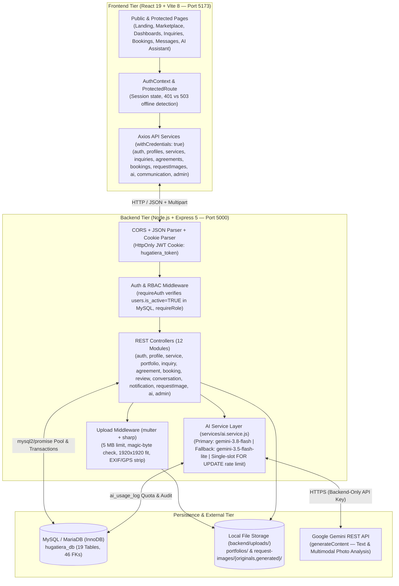
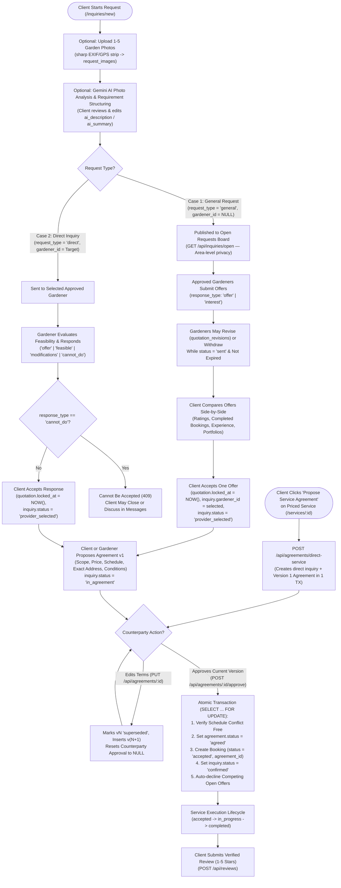

# HugaTiera — System Architecture, User Roles, Workflows & AI Assistant

This document describes the implemented architecture, role responsibilities, end-to-end service request and mutual agreement workflows, and the Gemini AI Garden Planning Assistant in **HugaTiera**.

---

## 1. System Architecture

HugaTiera uses a three-tier client–server architecture separating the **React + Vite Frontend**, the **Node.js + Express REST API Backend**, and the **MySQL (`InnoDB`) Relational Database**, with backend-mediated integration to the **Google Gemini API** and local file storage for sanitized images.

### 1.1 Architectural Responsibilities
1. **Frontend (`frontend/src/`):**
   - Renders responsive views across desktop, tablet, and mobile viewports.
   - Manages authentication session context (`AuthContext.jsx`) and distinguishes `401 Unauthorized` from `503 DATABASE_UNAVAILABLE` or network outages (rendering an offline retry screen rather than logging the user out).
   - Resolves backend image URLs via the centralized `API_ORIGIN` helper (`getRequestImageFileUrl(imageId)`) so authenticated `` tags carry the `HttpOnly` session cookie directly to the backend origin.
2. **Backend (`backend/`):**
   - Enforces authentication (`requireAuth`), live account activation (`users.is_active = TRUE`), role-based access control (`requireRole`), and strict resource ownership on every protected endpoint.
   - Wraps multi-table workflow mutations (inquiry creation with draft image attachment, quotation submission/acceptance, mutual agreement versioning/approval, booking confirmation, and review creation) in `mysql2/promise` transactions (`BEGIN` / `COMMIT` / `ROLLBACK`) with row-level `SELECT ... FOR UPDATE` locks where concurrency protection is required.
   - Processes uploaded garden photos with `sharp` to validate image streams, apply EXIF orientation, resize within `1920×1920`, and strip all EXIF/GPS/XMP/IPTC metadata before writing to disk.
3. **Database (`hugatiera_db`):**
   - Enforces relational integrity via `19` `InnoDB` tables, `46` foreign keys, `CHECK` constraints, and stored generated columns (`quotations.active_flag` and `agreements.active_key`) that guarantee at the database level at most one active offer per provider per inquiry and at most one active agreement per inquiry.

---

## 2. User Roles and Capabilities

### 2.1 Client (`role = 'client'`)
- **Discovery:** Browse and filter approved gardening services by keyword, category, service area, and sort order (`/services`), inspect service details (`/services/:serviceId`), and view public gardener profiles, portfolios, and verified reviews (`/gardeners/:gardenerId`).
- **AI Planning & Requirement Assistance:** Use the standalone Garden Planning Assistant (`/assistant`) or the embedded AI helpers inside `/inquiries/new` to structure requirements (`POST /api/ai/requirements`) and analyze uploaded garden photos (`POST /api/ai/photo-analysis`), then review and edit all AI suggestions before submission.
- **Case 1 — General Service Request:** Submit an open request (`request_type = 'general'`) with up to 5 EXIF-stripped garden photos and an optional validity period (`7`, `14`, or `30` days), compare offers from multiple approved gardeners side by side (including ratings, completed booking counts, experience, and portfolio previews), and accept or decline offers.
- **Case 2 — Direct Service Provider Inquiry:** Submit a direct inquiry (`request_type = 'direct'`) to a specific approved gardener or service, review the provider's feasibility response (`offer`, `feasible`, `modifications`, `cannot_do`), and accept or decline.
- **Priced-Service Direct Agreement:** Initiate a direct service request + mutual agreement proposal (`POST /api/agreements/direct-service`) from any active service listing with an indicative price.
- **Mutual Agreement & Booking Lifecycle:** Propose, edit (creating version $N+1$), approve, or cancel mutual agreements; track confirmed bookings (`accepted` → `in_progress` → `completed`), view the read-only **Mutual Agreement Summary** on booking details, and submit a 1–5 star review once a booking is marked `completed`.
- **Dashboard & Settings (`ISS-05`):** View primary workflow activity (requests, offers, agreements, bookings) on the `Overview` tab and manage personal/address details in the dedicated `Profile & Settings` tab.

### 2.2 Gardener (`role = 'gardener'`)
- **Professional Profile & Approval:** Maintain business name (optional, with automatic full-name fallback across all views), service area, years of experience, and description in the `Profile & Settings` tab. New gardeners start with `is_approved = FALSE` until approved by an administrator.
- **Service Listings & Portfolio:** Create, update, and deactivate gardening service listings (`/api/services`) and upload/edit/delete portfolio project photos (`/api/portfolios`).
- **Open Service Requests Board (Case 1):** Approved gardeners browse non-expired open general requests (`GET /api/inquiries/open`) filtered by category or service area, inspect the **Provider Decision-Support View** (client requirements, AI requirement summary, and garden photos with space notes), and submit, revise (`PUT /api/inquiries/quotations/:quotationId`), or withdraw (`POST /api/inquiries/quotations/:quotationId/withdraw`) offers until client acceptance.
- **Direct Inquiries (Case 2):** Evaluate direct client inquiries and respond with `offer`, `feasible`, `modifications` (with required `proposedChanges`), or `cannot_do`.
- **Mutual Agreement & Service Execution:** Propose, revise, or approve mutual agreements; transition confirmed bookings from `accepted` to `in_progress` and `completed`.

### 2.3 Administrator (`role = 'administrator'`)
- **Platform Summary & Statistics (`ISS-06`):** View live platform metrics on `/dashboard`, including Total Users, Active Services, Pending Gardener Approvals, Inquiries (`open` vs `total`), Bookings (`completed` vs `total`), and Open Reports.
- **Gardener Approval Queue:** Review pending gardener profiles (`GET /api/admin/gardeners/pending`) and approve or request changes (`PATCH /api/admin/gardeners/:userId/approval`) with automated in-app notifications.
- **Account & Category Management:** Activate or deactivate client and gardener accounts (`PATCH /api/admin/users/:userId/status` — immediately enforced by `requireAuth`) and create/edit/toggle service categories (`/api/admin/categories`).
- **Service, Activity & Report Moderation:** Moderate service listings (`PATCH /api/admin/services/:serviceId/status`), monitor platform-wide inquiries (including unassigned Case 1 general requests via `LEFT JOIN` with `"Open General Request"` fallback) and bookings (`GET /api/admin/activity`), and resolve or dismiss user-submitted reports (`PATCH /api/admin/reports/:reportId`).
- **Role-Appropriate Navigation (`ISS-06`):** Admin header navigation displays only `Admin Panel` and `Messages`, and backend `/api/bookings` and `GET /api/inquiries` routes enforce `requireRole('client', 'gardener')` (`403` for administrators).

---

## 3. Core End-to-End Business Workflows

### 3.1 Critical Business Rule: Mutual Agreement Before Booking Confirmation
> [!IMPORTANT]
> In HugaTiera, **an inquiry, general request, provider expression of interest, quotation, feasibility response, or client offer acceptance NEVER automatically creates a booking**. Both Case 1 (General Service Request) and Case 2 (Direct Service Provider Inquiry), as well as priced-service requests, must pass through a versioned **Mutual Agreement** (`agreements` table). A confirmed booking (`bookings.status = 'accepted'`) is created **only** when both the client and the gardener have approved the **exact same agreement version**.

### 3.2 Case 1 (General Service Request) vs Case 2 (Direct Provider Inquiry) Flowchart

### 3.3 Workflow State Transitions Summary

| Entity | Column | Allowed States & Transitions |
|---|---|---|
| **Inquiry / Request** | `inquiries.status` | `open` → `responded` → `provider_selected` → `in_agreement` → `confirmed` Terminal/Alternate: `expired` (renewable back to `open`/`responded`), `closed`, `cancelled` |
| **Quotation / Offer** | `quotations.status` | `draft` / `sent` → `accepted` (locks offer via `locked_at`) or `declined` or `withdrawn` (by gardener before acceptance) or `expired` |
| **Mutual Agreement** | `agreements.status` | `proposed` → `agreed` (when both `client_approved_at` and `gardener_approved_at` are set on the same version) or `superseded` (when edited into version $N+1$) or `cancelled` |
| **Booking** | `bookings.status` | `accepted` (created by agreement approval) → `in_progress` → `completed` or `cancelled` (`pending` and `declined` exist only for legacy pre-R3 rows) |

---

## 4. AI Garden Planning Assistant Architecture & Behavior

### 4.1 Supported AI Features
All AI capabilities are mediated exclusively through `backend/services/ai.service.js` and `backend/controllers/ai.controller.js`:
1. **Standalone Garden Planning (`POST /api/ai/garden-plan`):** Generates structured tropical/Zamboanga-appropriate garden planning guidance from a user prompt (up to `3,000` characters).
2. **Inquiry Requirement Structuring (`POST /api/ai/requirements`):** Takes a client's draft notes, location, and optional photo descriptions and returns structured JSON (`structuredSummary`, `refinedDescription`, `suggestedCategoryId`, `suggestedCategoryName`, `gardeningIdeas`, `followUpQuestions`) that the client can edit and apply to their request.
3. **Multimodal Garden Photo Analysis (`POST /api/ai/photo-analysis`):** Sends a client's `sharp`-sanitized `request_images` file (`inline_data` base64) to Gemini and saves an editable 2–4 sentence space observation to `request_images.ai_description`.
4. **Postponed Image Generation Guard:** `generateGardenImage` explicitly throws HTTP `501` (`IMAGE_GENERATION_POSTPONED`) so paid image generation cannot be triggered without future scope approval.

### 4.2 Model Configuration & Automatic Fallback (`R6 / R7`)

| Environment Variable | Default Value | Purpose |
|---|---|---|
| `GEMINI_API_KEY` | *(Required in `backend/.env`)* | Backend-only Google Gemini API key (never exposed to frontend) |
| `GEMINI_MODEL` | `gemini-3.8-flash` | Primary model for text and multimodal photo understanding |
| `GEMINI_FALLBACK_MODEL` | `gemini-3.5-flash-lite` | Automatic fallback model on transient primary failure |
| `GEMINI_THINKING_LEVEL` | `low` | Passed in `thinkingConfig: { thinkingLevel: 'low' }` for Gemini 3.x models |
| `AI_HOURLY_LIMIT` | `10` | Per-user rolling 60-minute call limit across all 3 AI features |

#### Automatic Fallback Rules (`executeWithModelFallback`):
- **Trigger Conditions (`isEligibleForFallback`):** Retries **once** using `GEMINI_FALLBACK_MODEL` (`gemini-3.5-flash-lite`) only when the primary model (`gemini-3.8-flash`) fails with a transient upstream error:
  - HTTP `429` (`PROVIDER_QUOTA` / rate limit)
  - HTTP `500`, `502`, `503`, `504` (`PROVIDER_ERROR` / overload)
  - Request timeout (`TIMEOUT` / `AbortError` after 20 seconds)
  - Transient network failure (`NETWORK_ERROR` / `ECONNRESET`)
- **Non-Retryable Errors:** Never retries on `400` bad request, `401`/`403` invalid API key (`AUTH_ERROR`), or input validation errors.
- **Single Quota Slot Consumption:** A primary attempt followed by a fallback retry counts as **one** user operation in `ai_usage_log` (updating the single in-flight reservation row rather than inserting a second row).
- **Audit Logging in `ai_usage_log`:**
  - Primary succeeds: `model = 'gemini-3.8-flash'`, `outcome = 'success'`, `error_code = NULL`
  - Primary fails transiently, fallback succeeds: `model = 'gemini-3.5-flash-lite'`, `outcome = 'success'`, `error_code = 'FALLBACK_FROM_<PRIMARY_CODE>'`
  - Both primary and fallback fail: `model = 'gemini-3.8-flash->gemini-3.5-flash-lite'`, `outcome = 'error'`, `error_code = 'FALLBACK_FAILED:<PRIMARY_CODE>-><FALLBACK_CODE>'`
