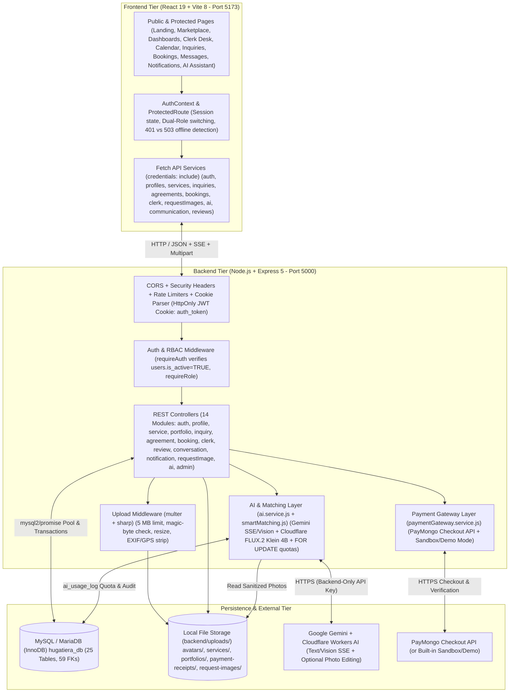
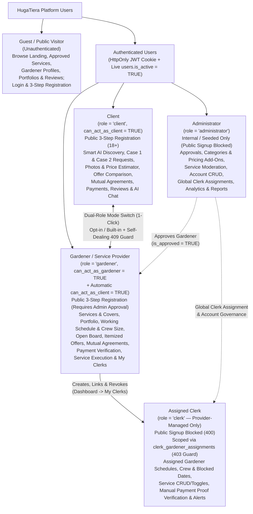

# HugaTiera — System Architecture, User Roles, Workflows & AI Assistant

This document describes the implemented architecture, role responsibilities, end-to-end service request and mutual agreement workflows, and the Gemini AI Garden Planning Assistant in **HugaTiera**.

---

## 1. System Architecture

HugaTiera uses a three-tier client–server architecture separating the **React + Vite Frontend**, the **Node.js + Express REST API Backend**, and the **MySQL (`InnoDB`) Relational Database** (`25` tables, `59` foreign keys, Migrations `001`–`014`), with backend-mediated integration to the **Google Gemini API** (SSE streaming text, vision & prompt guard), optional free-tier **Cloudflare Workers AI** (`@cf/black-forest-labs/flux-2-klein-4b` photo concept editing), **PayMongo Checkout / Sandbox Gateway**, and local file storage for `sharp`-sanitized images.

### 1.1 Architectural Responsibilities
1. **Frontend (`frontend/src/`):**
   - Renders responsive views across desktop, tablet, and mobile viewports.
   - Manages authentication session context (`AuthContext.jsx`) and distinguishes `401 Unauthorized` from `503 DATABASE_UNAVAILABLE` or network outages (rendering an offline retry screen rather than logging the user out).
   - Resolves backend image URLs via the centralized `API_ORIGIN` helper (`getRequestImageFileUrl(imageId)`) so authenticated `` tags carry the `HttpOnly` session cookie directly to the backend origin.
2. **Backend (`backend/`):**
   - Enforces authentication (`requireAuth`), live account activation (`users.is_active = TRUE`), role-based access control (`requireRole`), and strict resource ownership on every protected endpoint.
   - Wraps multi-table workflow mutations (inquiry creation with draft image attachment, quotation submission/acceptance, mutual agreement versioning/approval, booking confirmation, and review creation) in `mysql2/promise` transactions (`BEGIN` / `COMMIT` / `ROLLBACK`) with row-level `SELECT ... FOR UPDATE` locks where concurrency protection is required.
   - Processes uploaded garden photos with `sharp` to validate image streams, apply EXIF orientation, resize within `1920×1920`, and strip all EXIF/GPS/XMP/IPTC metadata before writing to disk.
3. **Database (`hugatiera_db`):**
   - Enforces relational integrity via `25` `InnoDB` tables, `59` foreign keys, `CHECK` constraints, and stored generated columns (`quotations.active_flag` and `agreements.active_key`) that guarantee at the database level at most one active offer per provider per inquiry and at most one active agreement per inquiry.

---

## 2. User Roles and Capabilities

### 2.1 Client (`role = 'client'` or Dual-Role `can_act_as_client = TRUE`)
- **3-Step Registration & Basic Info:** Registers via the guided 3-step `/register` wizard (**Find a gardener** card) with optional middle name, required 18+ birthday, mobile number (10–15 digits), and Zamboanga City address/city (`users.middle_name`, `users.date_of_birth`). May enable Gardener mode later via 1-click sidebar/profile opt-in (`is_approved = FALSE` until approved by an Administrator).
- **Discovery & Smart AI Matching:** Browse and filter approved gardening services (`/services`), view recommended nearby services filtered by live **Service Category dropdown** (`categoryId`) and recent verified reviews directly on the Client Dashboard (`ClientDiscoveryShowcase` via `GET /api/ai/recommendations` and `GET /api/reviews/recent`), inspect service details (`/services/:serviceId`), and check gardener availability/crew capacity (`/gardeners/:gardenerId`).
- **Price Estimator, Category Specs & AI Planning:** Use the per-sq.m **Amount Predictor** (`POST /api/inquiries/estimate`), select itemized plant/material/equipment/disposal add-ons, add client price comments, fill dynamic category-specific specs (`category_specs`), and run Gemini photo analysis / requirement structuring before submission.
- **Case 1 & Case 2 Requests, Mutual Agreements, Reservations & Payments:** Submit open general requests or direct inquiries, compare offers, approve versioned **Mutual Agreements** (which create a **Reservation** with a required deposit), settle deposits/balances via **PayMongo Checkout**, **Sandbox/Demo Checkout**, or manual receipt proof (`TXN-...`), request or approve **event-based cancellations / reschedules**, confirm the **mutual Transaction Completion Agreement**, and submit a verified 1–5 star review once `completed` + `fully_paid` + `closed`.

### 2.2 Gardener (`role = 'gardener'`)
- **Profile, Optional Dual Role, Schedule, Crew Capacity & My Staff:** Registers via the 3-step `/register` wizard (**Offer services** card) as a Gardener-only account by default (`can_act_as_gardener = TRUE`, `can_act_as_client = FALSE`), with optional Dual Role opt-in and mode switching inside **Profile → Account capabilities**. Maintain profile details, avatar, working days/hours, blocked dates (`gardener_unavailable_dates`), simultaneous job limit (`max_concurrent_jobs`), daily **crew size** (`crew_size`), and provider-managed **My Staff** (`GardenerClerksPanel.jsx`). New gardeners start with `is_approved = FALSE` until approved by an administrator.
- **Service Listings & Portfolio:** Create, update, upload cover/design photos (`services.image_path`), set `workers_required`, and manage portfolio project galleries (`/api/portfolios`).
- **Schedule Calendar Dropdown & Urgency Alerts:** Manage schedules via `<GardenerScheduleCalendar />` with **Overdue / Urgent Today / Due Tomorrow / Action Needed** reminders and automatic "Fully Booked" day detection.
- **Open Requests Board, Itemized Offers & Payment Verification:** Browse AI-ranked open leads (`GET /api/inquiries/open`, supporting `categoryId` filtering), submit itemized labor + materials offers with `estimated_working_days`/`estimated_hours`, verify manual payment proofs, execute confirmed paid bookings (`in_progress` → `completed`), handle event cancellations/reschedules, and sign off on the Transaction Completion Agreement.

### 2.3 Assigned Clerk (`role = 'clerk'` — Provider-Managed Only)
- **No Public Self-Registration:** Public `POST /api/auth/register` rejects `role = 'clerk'` (`400`). Clerks are created directly by a Gardener inside **Dashboard → My Clerks** (or assigned by an Administrator) and sign in at `/login`.
- **Scoped Gardener Operations (`clerk_gardener_assignments`):** Linked to one or more gardeners in `clerk_gardener_assignments` with strict `403 NOT_ASSIGNED_TO_GARDENER` protection against accessing unassigned providers.
- **Dedicated Clerk Desk (`<ClerkDashboard />` + `/api/clerk/*`):** Manages assigned gardeners' working days/hours, crew size, blocked dates, service listings, manual payment proof verification, and receives in-app notifications (`/notifications`) without accessing unassigned gardeners or admin controls.

### 2.4 Administrator (`role = 'administrator'`)
- **Separated Dashboard Pages (`Overview`, `Analytics`, `Approvals`, `Activity`, `Reports`, `Accounts`):**
  - `Overview` & `Analytics`: Live platform KPIs, pipeline/supply/account health meters, and operational breakdown report.
  - `Approvals` & Pricing: Review pending gardeners, manage service categories (including per-sq.m baseline rates), configure `pricing_addons` (plants/materials/equipment/disposal), and moderate service listings.
  - `Accounts` & Clerk Assignments: Edit user details/roles (`PATCH /api/admin/users/:userId`), toggle activation, safely delete unreferenced accounts (`DELETE /api/admin/users/:userId` with `409` `ON DELETE RESTRICT` protection), and manage `clerk_gardener_assignments`.
  - `Activity` & `Reports`: Monitor platform inquiries/bookings and resolve user reports.

### 2.5 User Role Hierarchy & Delegation Diagram

---

## 3. Core End-to-End Business Workflows

### 3.1 Critical Business Rule: Mutual Agreement Before Booking Confirmation
> [!IMPORTANT]
> In HugaTiera, **an inquiry, general request, provider expression of interest, quotation, feasibility response, or client offer acceptance NEVER automatically creates a booking**. Both Case 1 (General Service Request) and Case 2 (Direct Service Provider Inquiry), as well as priced-service requests, must pass through a versioned **Mutual Agreement** (`agreements` table). Only when both the client and the gardener approve the **exact same agreement version** does the backend create a **Reservation** (`bookings.status = 'accepted'`, `booking_stage = 'reserved'`), which upgrades to a **Confirmed Paid Booking** (`booking_stage = 'booked'`) once the required deposit is verified.

### 3.2 Case 1 (General Service Request) vs Case 2 (Direct Provider Inquiry) Flowchart

```mermaid
flowchart TD
  Start(["Client Starts Request (/inquiries/new)"]) --> SpecsEst["Fill Category Specs (category_specs) &<br/>Live Per-Sq.m / Add-on Price Estimator<br/>(POST /api/inquiries/estimate)"]
  SpecsEst --> PhotoUpload["Optional: Upload 1-5 Garden Photos<br/>(sharp EXIF/GPS strip -> request_images)"]
  PhotoUpload --> AIHelp["Optional: Gemini AI Photo Analysis & Requirement Structuring<br/>(Client reviews & edits ai_description / ai_summary)"]
  AIHelp --> ChooseType{"Request Type?"}

  %% Case 1 Branch
  ChooseType -->|"Case 1: General Request<br/>(request_type = 'general', gardener_id = NULL)"| OpenBoard["Published to Open Requests Board<br/>(GET /api/inquiries/open — Area-level privacy)"]
  OpenBoard --> MultiOffers["Approved Gardeners Submit Itemized Offers<br/>(response_type: 'offer' | 'interest', labor + materials)"]
  MultiOffers --> ReviseOrWithdraw["Gardeners May Revise (quotation_revisions) or Withdraw<br/>While status = 'sent' & Not Expired"]
  ReviseOrWithdraw --> ClientCompare["Client Compares Offers Side-by-Side<br/>(Smart AI Score, Ratings, Completed Bookings, Portfolios)"]
  ClientCompare --> AcceptOffer1["Client Accepts One Offer<br/>(quotation.locked_at = NOW(), inquiry.gardener_id = selected,<br/>inquiry.status = 'provider_selected')"]

  %% Case 2 Branch
  ChooseType -->|"Case 2: Direct Inquiry<br/>(request_type = 'direct', gardener_id = Target)"| DirectTarget["Sent to Selected Approved Gardener"]
  DirectTarget --> Feasibility["Gardener Evaluates Feasibility & Responds<br/>('offer' | 'feasible' | 'modifications' | 'cannot_do')"]
  Feasibility --> CheckCannotDo{"response_type == 'cannot_do'?"}
  CheckCannotDo -->|"Yes"| CannotAccept["Cannot Be Accepted (409)<br/>Client May Close or Discuss in Messages"]
  CheckCannotDo -->|"No"| AcceptOffer2["Client Accepts Response<br/>(quotation.locked_at = NOW(),<br/>inquiry.status = 'provider_selected')"]

  %% Priced Service Branch
  PricedStart(["Client Clicks 'Propose Service Agreement'<br/>on Priced Service (/services/:id)"]) --> DirectServiceAPI["POST /api/agreements/direct-service<br/>(Creates direct inquiry + Version 1 Agreement in 1 TX)"]

  %% Convergence on R3 Mutual Agreement Engine
  AcceptOffer1 --> ProposeAgreement["Client or Gardener Proposes Agreement v1<br/>(Scope, Price, Deposit, Schedule, Exact Address, Conditions)<br/>inquiry.status = 'in_agreement'"]
  AcceptOffer2 --> ProposeAgreement
  DirectServiceAPI --> AgreementLoop

  ProposeAgreement --> AgreementLoop{"Counterparty Action?"}
  AgreementLoop -->|"Edits Terms (PUT /api/agreements/:id)"| NewVersion["Marks vN 'superseded', Inserts v(N+1)<br/>Resets Both Approvals to NULL"]
  NewVersion --> AgreementLoop

  AgreementLoop -->|"Approves Current Version<br/>(POST /api/agreements/:id/approve)"| SecondApproval["Atomic Transaction (SELECT ... FOR UPDATE):<br/>1. Validate Working Days, Blocked Dates & Daily Crew Capacity<br/>2. Set agreement.status = 'agreed'<br/>3. Create Reservation (status = 'accepted', booking_stage = 'reserved')<br/>4. Set inquiry.status = 'confirmed' & Auto-decline Competing Offers"]

  SecondApproval --> DepositGate["Deposit Payment Gate (TXN-...):<br/>PayMongo Checkout, Sandbox/Demo, or Manual Receipt Proof<br/>(Verified by Gardener / Assigned Clerk -> booking_stage = 'booked')"]
  DepositGate --> Execution["Service Execution Lifecycle<br/>(accepted -> in_progress -> completed)<br/>Optional: Event-Based Cancel or Mutual Reschedule"]
  Execution --> Closure["Final Balance (payment_status = 'fully_paid') +<br/>Mutual Transaction Completion Agreement<br/>(transaction_status = 'closed')"]
  Closure --> Review["Client Submits Verified Review (1-5 Stars)<br/>(POST /api/reviews)"]
```

### 3.3 Workflow State Transitions Summary

| Entity | Column | Allowed States & Transitions |
|---|---|---|
| **Inquiry / Request** | `inquiries.status` | `open` → `responded` → `provider_selected` → `in_agreement` → `confirmed` Terminal/Alternate: `expired` (renewable back to `open`/`responded`), `closed`, `cancelled` |
| **Quotation / Offer** | `quotations.status` | `draft` / `sent` → `accepted` (locks offer via `locked_at`) or `declined` or `withdrawn` (by gardener before acceptance) or `expired` |
| **Mutual Agreement** | `agreements.status` | `proposed` → `agreed` (when both `client_approved_at` and `gardener_approved_at` are set on the same version) or `superseded` (when edited into version $N+1$) or `cancelled` |
| **Booking** | `bookings.status` | `accepted` (created as a reservation by agreement approval) → `in_progress` (once deposit paid) → `completed` or event-based `cancelled` (`pending` and `declined` exist only for legacy pre-R3 rows) |
| **Booking Stage & Payment** | `bookings.booking_stage`, `payment_status` | `reserved` (`unpaid` / `pending_verification`) → `booked` (`partially_paid` / `fully_paid` once verified deposit meets `required_deposit_amount`) |
| **Transaction Closure** | `bookings.transaction_status` | `open` → `pending_closure` (one party confirmed completion) → `closed` (both confirmed + `completed` + `fully_paid`; unlocks 1–5 star review) |
| **Reschedule Request** | `booking_reschedule_requests.status` | `pending` → `approved` (updates booking dates after crew/schedule validation), `declined`, or `cancelled` |

---

## 4. AI Garden Planning Assistant Architecture & Behavior

### 4.1 Supported AI Features
All AI capabilities are mediated exclusively through `backend/services/ai.service.js` and `backend/controllers/ai.controller.js`:
1. **Standalone Tropical Garden Planning (`POST /api/ai/garden-plan` & `POST /api/ai/garden-plan/stream`):** Generates or streams (SSE) concise Zamboanga City garden planning guidance from a user prompt (up to `3,000` characters) under strict gardening-only `systemInstruction` domain guardrails (`GARDEN_PLAN_SYSTEM_INSTRUCTION`) that decline off-topic prompts.
2. **Inquiry Requirement & Material Structuring (`POST /api/ai/requirements`):** Takes a client's draft notes, location, optional `areaSqm`, active `pricing_addons`, and photo descriptions and returns structured JSON (`structuredSummary`, `refinedDescription`, `suggestedCategoryId`, `suggestedCategoryName`, validated `suggestedAddons` mapped strictly to real DB catalog items, `gardeningIdeas`, `followUpQuestions`). Pricing is always computed deterministically by `priceEstimator.js`—AI never sets binding prices.
3. **Multimodal Garden Photo Analysis (`POST /api/ai/photo-analysis`):** Sends a client's `sharp`-sanitized `request_images` file (`inline_data` base64) to Gemini and saves an editable 2–4 sentence space observation to `request_images.ai_description`.
4. **Optional Free-Tier Instruction-Based Photo Concept Editing (`POST /api/ai/garden-image`):** Gated behind `AI_IMAGE_GEN_ENABLED=true` (`501 IMAGE_GENERATION_POSTPONED` when disabled). Uses Gemini (`refineGardenImageEditPrompt`) as a gardening-only prompt guard/refiner (`400 OFF_TOPIC_EDIT` for unrelated edits), then calls **Cloudflare Workers AI** (`@cf/black-forest-labs/flux-2-klein-4b`, `multipart/form-data` `input_image_0`) to edit the client's actual yard photo while keeping physical structures intact. Returned bytes are re-encoded via `sharp`, stored separately in `uploads/request-images/generated/`, linked via `request_images.kind = 'ai_generated'` and `parent_image_id`, and metered under a separate 24-hour quota (`AI_IMAGE_DAILY_LIMIT`, default `3`/day).
5. **Smart Hybrid Proximity & Conduct Matching (`GET /api/ai/recommendations`, `POST /api/ai/recommendations/summary`):** Scores approved services, competing offers, and open leads using Zamboanga City barangay proximity, live `categoryId` filtering, verified review ratings, and good-conduct metrics (`smartMatching.js`), with optional Gemini explanation summaries.

### 4.2 Model Configuration & Automatic Fallback (`R6 / R7` & Migration `014`)

| Environment Variable | Default / Recommended Value | Purpose |
|---|---|---|
| `GEMINI_API_KEY` | *(Required in `backend/.env`)* | Backend-only Google Gemini API key (never exposed to frontend) |
| `GEMINI_MODEL` | `gemini-3.5-flash-lite` *(fast)* / `gemini-3.8-flash` | Primary model for SSE streaming text, requirements, photo analysis & edit guard |
| `GEMINI_FALLBACK_MODEL` | `gemini-3.8-flash` / `gemini-3.5-flash-lite` | Automatic fallback model on transient primary failure or 8s first-chunk timeout |
| `GEMINI_THINKING_LEVEL` | `low` *(auto `minimal` for `-lite` chat)* | Model-aware `thinkingConfig` for Gemini 3.x models |
| `AI_HOURLY_LIMIT` | `10` | Per-user rolling 60-minute call limit across text & photo-analysis features |
| `AI_IMAGE_GEN_ENABLED` | `false` *(set `true` to enable)* | Feature flag for free-tier Cloudflare Workers AI photo concept editing (`501` when `false`) |
| `CF_ACCOUNT_ID` / `CF_API_TOKEN` | *(Optional in `backend/.env`)* | Backend-only Cloudflare Workers AI credentials (10,000 free Neurons/day) |
| `CF_IMAGE_TO_IMAGE_MODEL` | `@cf/black-forest-labs/flux-2-klein-4b` | Instruction-based photo-editing model (`multipart/form-data` `input_image_0`) |
| `AI_IMAGE_DAILY_LIMIT` | `3` | Separate per-user rolling 24-hour cap for `image_generation` in `ai_usage_log` |

#### Automatic Fallback Rules (`executeWithModelFallback`):
- **Trigger Conditions (`isEligibleForFallback`):** Retries **once** using `GEMINI_FALLBACK_MODEL` (`gemini-3.5-flash-lite`) only when the primary model (`gemini-3.8-flash`) fails with a transient upstream error:
  - HTTP `429` (`PROVIDER_QUOTA` / rate limit)
  - HTTP `500`, `502`, `503`, `504` (`PROVIDER_ERROR` / overload)
  - Request timeout (`TIMEOUT` / `AbortError` after 30 seconds)
  - Transient network failure (`NETWORK_ERROR` / `ECONNRESET`)
- **Non-Retryable Errors:** Never retries on `400` bad request, `401`/`403` invalid API key (`AUTH_ERROR`), or input validation errors.
- **Single Quota Slot Consumption:** A primary attempt followed by a fallback retry counts as **one** user operation in `ai_usage_log` (updating the single in-flight reservation row rather than inserting a second row).
- **Audit Logging in `ai_usage_log`:**
  - Primary succeeds: `model = 'gemini-3.8-flash'`, `outcome = 'success'`, `error_code = NULL`
  - Primary fails transiently, fallback succeeds: `model = 'gemini-3.5-flash-lite'`, `outcome = 'success'`, `error_code = 'FALLBACK_FROM_<PRIMARY_CODE>'`
  - Both primary and fallback fail: `model = 'gemini-3.8-flash->gemini-3.5-flash-lite'`, `outcome = 'error'`, `error_code = 'FALLBACK_FAILED:<PRIMARY_CODE>-><FALLBACK_CODE>'`
