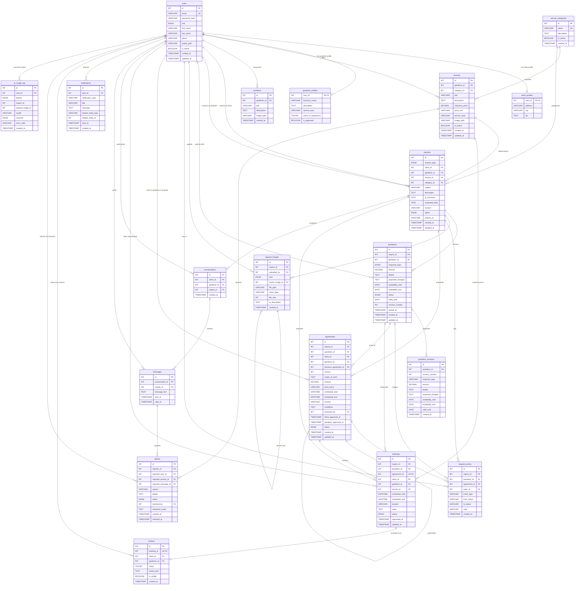
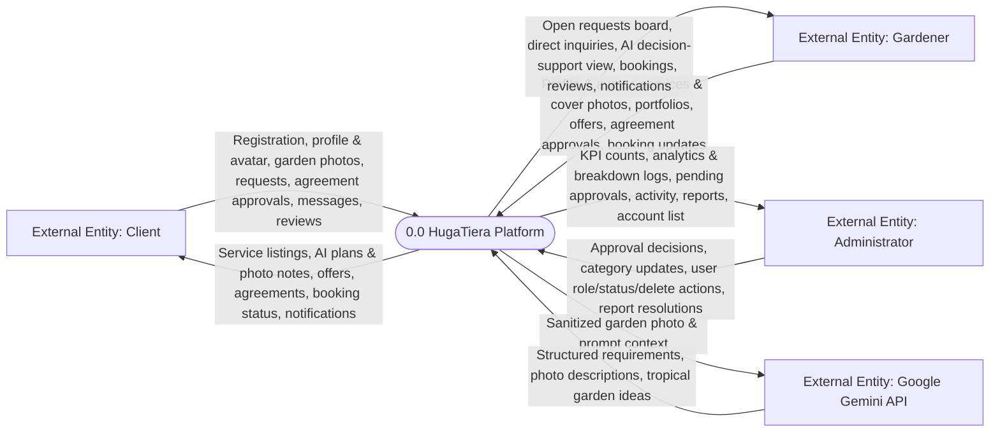
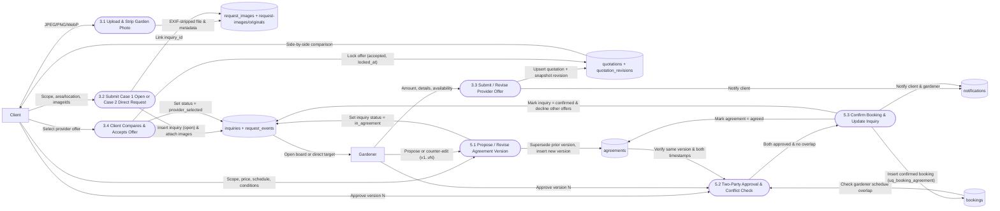

# HugaTiera — Entity-Relationship Diagram (ERD) and Data Flow Diagrams (DFD)

This document describes the database structure and data flows of **HugaTiera**, grounded directly in the 19-table MySQL schema ([hugatiera_schema.sql](../database/schema/hugatiera_schema.sql), updated through Migration 001 and Migration 002).

---

## 1. Entity-Relationship Diagram (ERD)

### 1.1 Full 19-Table Database ERD

### 1.2 Domain Grouping & Key Integrity Rules

| Domain | Tables | Key Schema & Integrity Rules |
|---|---|---|
| **Identity & Profiles** | `users`, `client_profiles`, `gardener_profiles` | `users.role` is `client`, `gardener`, or `administrator`. `users.avatar_path` stores optional profile pictures. `gardener_profiles.is_approved` gates public marketplace visibility. |
| **Marketplace & Portfolios** | `service_categories`, `services`, `portfolios` | `services.image_path` stores optional service cover/business design photos. `category_id` uses `ON DELETE RESTRICT` to preserve historical listings. |
| **Unified Request Engine** | `inquiries`, `quotations`, `quotation_revisions`, `request_images`, `request_events` | Supports Case 1 (`general`, `gardener_id` nullable) and Case 2 (`direct`, `gardener_id` required via `chk_inquiries_direct_has_provider`). `uq_quotation_active_offer` prevents duplicate active offers per provider per inquiry. |
| **Agreements & Bookings** | `agreements`, `bookings`, `reviews` | `agreements` enforces `chk_agreement_agreed_needs_both` and `uq_one_active_agreement`. `bookings.agreement_id` is unique (`uq_booking_agreement`), ensuring one confirmed booking per agreed agreement. `reviews.booking_id` is unique (`uq_review_booking`). |
| **Communication & Governance** | `conversations`, `messages`, `notifications`, `reports`, `ai_usage_log` | `uq_conversation_inquiry_provider` keeps one thread per inquiry-provider pair. `ai_usage_log` records per-user Gemini usage (`requirements`, `photo_analysis`, `garden_plan`) for 10/hour rate limiting. |

---

## 2. Data Flow Diagrams (DFD)

### 2.1 Level 0 — Context Diagram

### 2.2 Level 1 — System Data Flow Diagram

```mermaid
flowchart TD
  Client["Client"]
  Gardener["Gardener"]
  Admin["Administrator"]
  Gemini["Google Gemini API"]

  P1(["1.0 Auth & Profile Management"])
  P2(["2.0 Marketplace, Services & Portfolios"])
  P3(["3.0 Unified Request & Offer Engine"])
  P4(["4.0 AI Garden Assistant"])
  P5(["5.0 Mutual Agreement & Booking Engine"])
  P6(["6.0 Messaging, Notifications & Reviews"])
  P7(["7.0 Admin Moderation & Analytics"])

  D1[("D1: users, client_profiles, gardener_profiles")]
  D2[("D2: service_categories, services, portfolios")]
  D3[("D3: inquiries, request_images, request_events")]
  D4[("D4: quotations, quotation_revisions")]
  D5[("D5: agreements, bookings")]
  D6[("D6: conversations, messages, notifications")]
  D7[("D7: reviews, reports")]
  D8[("D8: ai_usage_log")]
  FS[("D9: Local Media Storage (avatars, services, portfolios, request-images)")]

  Client <-->|"Credentials, profile, avatar"| P1
  Gardener <-->|"Credentials, profile, avatar"| P1
  P1 <-->|"Read/write user & profile rows"| D1
  P1 <-->|"Store/serve avatar files"| FS

  Gardener <-->|"Service CRUD, cover photos, portfolios"| P2
  Client -->|"Search, filter, view profiles"| P2
  P2 <-->|"Read/write listings & categories"| D2
  P2 -->|"Check is_approved & is_active"| D1
  P2 <-->|"Store/serve cover & portfolio images"| FS

  Client <-->|"Create Case 1/Case 2 request & upload photos"| P3
  Gardener <-->|"Browse open board, submit/revise offers"| P3
  P3 <-->|"Read/write inquiries, photos, events"| D3
  P3 <-->|"Read/write offers & revisions"| D4
  P3 <-->|"Store/serve EXIF-stripped garden photos"| FS
  P3 -->|"Notify counterparty"| P6

  Client <-->|"Photo analysis, requirements, garden plan"| P4
  Gardener <-->|"Garden plan queries"| P4
  P4 <-->|"Check/log 10-per-hour quota"| D8
  P4 -->|"Read photo metadata & update ai_description"| D3
  P4 <-->|"Multimodal & text requests"| Gemini

  Client <-->|"Propose, edit, approve agreement; view booking"| P5
  Gardener <-->|"Propose, edit, approve agreement; update progress"| P5
  P5 <-->|"Read/write versioned agreements & bookings"| D5
  P5 -->|"Lock accepted offer & update inquiry status"| D3
  P5 -->|"Read offer basis"| D4
  P5 -->|"Emit agreement & booking notifications"| P6

  Client <-->|"Messages, notifications, reviews, reports"| P6
  Gardener <-->|"Messages, notifications, reports"| P6
  P6 <-->|"Read/write threads, messages, alerts"| D6
  P6 <-->|"Write reviews & user reports"| D7
  P6 -->|"Verify Case 1 offer gating & booking completion"| D4

  Admin <-->|"Approvals, analytics, categories, accounts, reports"| P7
  P7 <-->|"Approve gardeners, edit/role-change/delete users"| D1
  P7 <-->|"Manage categories & moderate services"| D2
  P7 -->|"Read activity & analytics"| D3
  P7 -->|"Read booking completion metrics"| D5
  P7 <-->|"Resolve flagged reports"| D7
  P7 -->|"Send approval notifications"| D6
```

### 2.3 Level 2 — Request-to-Confirmation & Mutual Agreement Flow (Processes 3.0 & 5.0)

