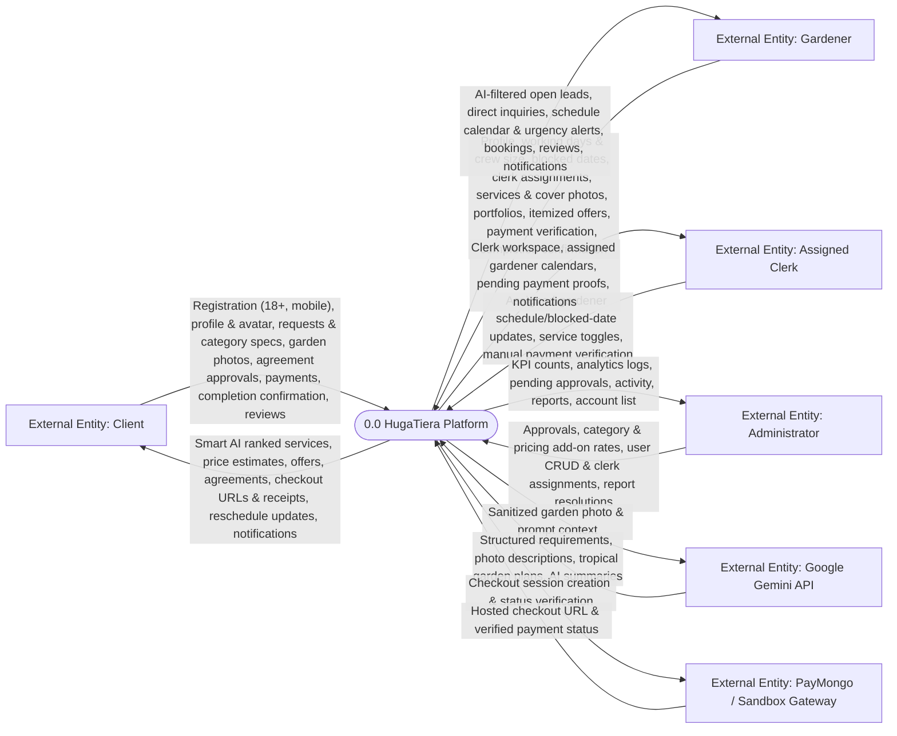
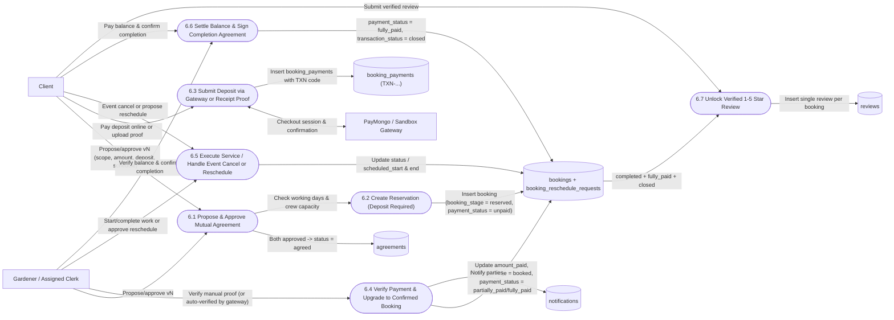

# HugaTiera — Entity-Relationship Diagram (ERD) and Data Flow Diagrams (DFD)

This document describes the database structure and data flows of **HugaTiera**, grounded directly in the **25-table, 59-foreign-key** MySQL schema ([hugatiera_schema.sql](../database/schema/hugatiera_schema.sql), updated through **Migrations `001`–`013`** on `main`).

---

## 1. Entity-Relationship Diagram (ERD)

### 1.1 Full 25-Table Database ERD

```mermaid
erDiagram
  users {
    INT id PK
    VARCHAR email UK
    VARCHAR password_hash
    ENUM role
    BOOLEAN can_act_as_client
    BOOLEAN can_act_as_gardener
    VARCHAR first_name
    VARCHAR middle_name
    VARCHAR last_name
    VARCHAR phone
    DATE date_of_birth
    VARCHAR avatar_path
    BOOLEAN is_active
    TIMESTAMP created_at
    TIMESTAMP updated_at
  }

  client_profiles {
    INT user_id PK,FK
    VARCHAR address
    VARCHAR city
    TEXT bio
  }

  gardener_profiles {
    INT user_id PK,FK
    VARCHAR business_name
    TEXT description
    VARCHAR service_area
    TINYINT years_of_experience
    VARCHAR working_days
    TIME work_start_time
    TIME work_end_time
    TINYINT max_concurrent_jobs
    TINYINT crew_size
    VARCHAR availability_notes
    BOOLEAN is_approved
  }

  gardener_unavailable_dates {
    INT id PK
    INT gardener_id FK
    DATE start_date
    DATE end_date
    VARCHAR reason
    TIMESTAMP created_at
  }

  clerk_gardener_assignments {
    INT id PK
    INT clerk_id FK
    INT gardener_id FK
    INT assigned_by FK
    VARCHAR notes
    TIMESTAMP created_at
  }

  service_categories {
    INT id PK
    VARCHAR name UK
    TEXT description
    DECIMAL rate_per_sqm_min
    DECIMAL rate_per_sqm_max
    DECIMAL min_base_fee
    BOOLEAN is_active
    TIMESTAMP created_at
  }

  pricing_addons {
    INT id PK
    VARCHAR name UK
    ENUM item_type
    VARCHAR unit
    DECIMAL unit_price_min
    DECIMAL unit_price_max
    VARCHAR description
    BOOLEAN is_active
    TIMESTAMP created_at
    TIMESTAMP updated_at
  }

  services {
    INT id PK
    INT gardener_id FK
    INT category_id FK
    VARCHAR title
    TEXT description
    DECIMAL indicative_price
    VARCHAR price_unit
    VARCHAR service_area
    TINYINT workers_required
    VARCHAR image_path
    BOOLEAN is_active
    TIMESTAMP created_at
    TIMESTAMP updated_at
  }

  portfolios {
    INT id PK
    INT gardener_id FK
    VARCHAR title
    TEXT description
    VARCHAR image_path
    TIMESTAMP created_at
  }

  inquiries {
    INT id PK
    ENUM request_type
    INT client_id FK
    INT gardener_id FK
    INT service_id FK
    INT category_id FK
    VARCHAR subject
    TEXT description
    TEXT ai_summary
    DATE requested_date
    VARCHAR location
    DECIMAL area_sqm
    ENUM work_complexity
    ENUM materials_option
    BOOLEAN site_visit_requested
    DECIMAL estimated_labor_min
    DECIMAL estimated_labor_max
    DECIMAL estimated_materials_min
    DECIMAL estimated_materials_max
    DECIMAL estimated_min_amount
    DECIMAL estimated_max_amount
    TEXT price_comment
    JSON category_specs
    ENUM status
    DATETIME expires_at
    TIMESTAMP created_at
    TIMESTAMP updated_at
  }

  inquiry_estimate_items {
    INT id PK
    INT inquiry_id FK
    INT addon_id FK
    VARCHAR item_name
    ENUM item_type
    VARCHAR unit
    DECIMAL quantity
    DECIMAL unit_price_min
    DECIMAL unit_price_max
    DECIMAL subtotal_min
    DECIMAL subtotal_max
    TIMESTAMP created_at
  }

  quotations {
    INT id PK
    INT inquiry_id FK
    INT gardener_id FK
    ENUM response_type
    DECIMAL amount
    DECIMAL labor_amount
    DECIMAL materials_amount
    TEXT materials_breakdown
    TEXT details
    TEXT proposed_changes
    BOOLEAN requires_site_visit
    DATE availability_start
    DATE availability_end
    DECIMAL estimated_working_days
    DECIMAL estimated_hours
    ENUM status
    DATE valid_until
    INT revision_number
    TIMESTAMP locked_at
    TIMESTAMP created_at
    TIMESTAMP updated_at
  }

  quotation_revisions {
    INT id PK
    INT quotation_id FK
    INT revision_number
    VARCHAR response_type
    DECIMAL amount
    DECIMAL labor_amount
    DECIMAL materials_amount
    TEXT materials_breakdown
    TEXT details
    TEXT proposed_changes
    BOOLEAN requires_site_visit
    DATE availability_start
    DATE availability_end
    DECIMAL estimated_working_days
    DECIMAL estimated_hours
    DATE valid_until
    TIMESTAMP created_at
  }

  request_images {
    INT id PK
    INT inquiry_id FK
    INT uploaded_by FK
    ENUM kind
    INT parent_image_id FK
    VARCHAR file_path
    VARCHAR mime_type
    INT file_size
    TEXT ai_description
    TIMESTAMP created_at
  }

  request_events {
    INT id PK
    INT inquiry_id FK
    INT quotation_id FK
    INT agreement_id FK
    INT actor_id FK
    VARCHAR event_type
    VARCHAR from_status
    VARCHAR to_status
    VARCHAR note
    TIMESTAMP created_at
  }

  agreements {
    INT id PK
    INT inquiry_id FK
    INT quotation_id FK
    INT client_id FK
    INT gardener_id FK
    INT previous_agreement_id FK
    INT version
    TEXT scope_of_work
    DECIMAL amount
    DECIMAL required_deposit_amount
    VARCHAR price_basis
    DATETIME scheduled_start
    DATETIME scheduled_end
    DECIMAL estimated_working_days
    VARCHAR location
    TEXT conditions
    INT proposed_by FK
    TIMESTAMP client_approved_at
    TIMESTAMP gardener_approved_at
    ENUM status
    TIMESTAMP created_at
    TIMESTAMP updated_at
  }

  bookings {
    INT id PK
    INT inquiry_id FK
    INT quotation_id FK
    INT agreement_id UK,FK
    INT client_id FK
    INT gardener_id FK
    INT service_id FK
    DATETIME scheduled_start
    DATETIME scheduled_end
    VARCHAR location
    TEXT notes
    ENUM status
    ENUM booking_stage
    ENUM payment_status
    DECIMAL required_deposit_amount
    DECIMAL amount_paid
    TIMESTAMP paid_at
    ENUM transaction_status
    TIMESTAMP client_completion_confirmed_at
    TIMESTAMP gardener_completion_confirmed_at
    TIMESTAMP transaction_closed_at
    TEXT completion_agreement_notes
    ENUM cancellation_reason_type
    VARCHAR cancellation_reason
    INT cancelled_by FK
    TIMESTAMP cancelled_at
    TIMESTAMP requested_at
    TIMESTAMP updated_at
  }

  booking_payments {
    INT id PK
    VARCHAR transaction_code UK
    INT booking_id FK
    INT submitted_by FK
    ENUM payment_type
    ENUM payment_method
    ENUM gateway_provider
    VARCHAR gateway_session_id
    VARCHAR gateway_checkout_url
    ENUM gateway_status
    TIMESTAMP gateway_paid_at
    DECIMAL amount
    VARCHAR reference_number
    VARCHAR receipt_path
    VARCHAR notes
    ENUM status
    INT verified_by FK
    TIMESTAMP verified_at
    VARCHAR rejection_reason
    TIMESTAMP created_at
    TIMESTAMP updated_at
  }

  booking_reschedule_requests {
    INT id PK
    INT booking_id FK
    INT requested_by FK
    ENUM reason_type
    VARCHAR reason_details
    DATETIME previous_start
    DATETIME previous_end
    DATETIME proposed_start
    DATETIME proposed_end
    ENUM status
    INT responded_by FK
    TIMESTAMP responded_at
    VARCHAR response_note
    TIMESTAMP created_at
    TIMESTAMP updated_at
  }

  conversations {
    INT id PK
    INT client_id FK
    INT gardener_id FK
    INT inquiry_id FK
    TIMESTAMP created_at
  }

  messages {
    INT id PK
    INT conversation_id FK
    INT sender_id FK
    TEXT message_text
    TIMESTAMP sent_at
    TIMESTAMP read_at
  }

  notifications {
    INT id PK
    INT user_id FK
    VARCHAR notification_type
    VARCHAR title
    TEXT message
    VARCHAR related_entity_type
    INT related_entity_id
    TIMESTAMP read_at
    TIMESTAMP created_at
  }

  reviews {
    INT id PK
    INT booking_id UK,FK
    INT client_id FK
    INT gardener_id FK
    TINYINT rating
    TEXT review_text
    BOOLEAN is_visible
    TIMESTAMP created_at
  }

  reports {
    INT id PK
    INT reporter_id FK
    INT reported_user_id FK
    INT reported_service_id FK
    INT reported_message_id FK
    VARCHAR reason
    TEXT details
    ENUM status
    INT resolved_by FK
    TEXT resolution_notes
    TIMESTAMP created_at
    TIMESTAMP resolved_at
  }

  ai_usage_log {
    INT id PK
    INT user_id FK
    ENUM feature
    INT inquiry_id
    INT request_image_id
    VARCHAR model
    ENUM outcome
    VARCHAR error_code
    TIMESTAMP created_at
  }

  users ||--o| client_profiles : "has client profile"
  users ||--o| gardener_profiles : "has gardener profile"
  users ||--o{ gardener_unavailable_dates : "blocks unavailable dates"
  users ||--o{ clerk_gardener_assignments : "clerk or assigned gardener"
  users ||--o{ services : "offers"
  users ||--o{ portfolios : "showcases"
  service_categories ||--o{ services : "classifies"
  service_categories ||--o{ inquiries : "categorizes"

  users ||--o{ inquiries : "submits as client"
  users ||--o{ inquiries : "receives as gardener"
  services ||--o{ inquiries : "referenced by"
  inquiries ||--o{ inquiry_estimate_items : "itemizes"
  pricing_addons |o--o{ inquiry_estimate_items : "priced from"

  inquiries ||--o{ quotations : "receives"
  users ||--o{ quotations : "submits offer"
  quotations ||--o{ quotation_revisions : "snapshots"

  inquiries ||--o{ request_images : "attaches"
  users ||--o{ request_images : "uploads"
  request_images ||--o{ request_images : "derives from"

  inquiries ||--o{ request_events : "logs"
  quotations ||--o{ request_events : "triggers"
  agreements ||--o{ request_events : "triggers"
  users ||--o{ request_events : "acts in"

  inquiries ||--o{ agreements : "negotiates"
  quotations ||--o{ agreements : "basis for"
  agreements ||--o| agreements : "supersedes"
  users ||--o{ agreements : "client or gardener or proposer"

  agreements ||--o| bookings : "creates reservation"
  inquiries ||--o{ bookings : "originates"
  quotations ||--o{ bookings : "linked offer"
  services ||--o{ bookings : "booked service"
  users ||--o{ bookings : "client, gardener, or canceller"

  bookings ||--o{ booking_payments : "records payments"
  users ||--o{ booking_payments : "submits or verifies"
  bookings ||--o{ booking_reschedule_requests : "requests date move"
  users ||--o{ booking_reschedule_requests : "requests or responds"

  users ||--o{ conversations : "participates"
  inquiries ||--o{ conversations : "scoped to"
  conversations ||--o{ messages : "contains"
  users ||--o{ messages : "sends"

  users ||--o{ notifications : "receives"
  bookings ||--o| reviews : "reviewed once when closed"
  users ||--o{ reviews : "writes and receives"

  users ||--o{ reports : "submits and resolves"
  services ||--o{ reports : "reported"
  messages ||--o{ reports : "reported"
  users ||--o{ ai_usage_log : "consumes quota"
```

### 1.2 Domain Grouping & Key Integrity Rules

| Domain | Tables | Key Schema & Integrity Rules |
|---|---|---|
| **Identity, Dual Roles & Clerks** | `users`, `client_profiles`, `gardener_profiles`, `gardener_unavailable_dates`, `clerk_gardener_assignments` | `users.role` is `client`, `gardener`, `clerk`, or `administrator`. `can_act_as_client` and `can_act_as_gardener` enable dual-role accounts with 1-click switching. `middle_name` (optional) and `date_of_birth` (18+ enforcement) support registration verification. `gardener_profiles` tracks `working_days`, `work_start_time`, `work_end_time`, `max_concurrent_jobs`, and `crew_size`. `clerk_gardener_assignments` enforces `UNIQUE(clerk_id, gardener_id)`. |
| **Marketplace, Pricing & Portfolios** | `service_categories`, `pricing_addons`, `services`, `portfolios` | `service_categories` stores per-sq.m baseline rates (`rate_per_sqm_min/max`, `min_base_fee`). `pricing_addons` provides configurable plant/material/equipment/disposal rates. `services` includes `workers_required` and optional cover photo `image_path`. |
| **Unified Request & Estimator Engine** | `inquiries`, `inquiry_estimate_items`, `quotations`, `quotation_revisions`, `request_images`, `request_events` | Supports Case 1 (`general`) and Case 2 (`direct`) requests, per-sq.m price prediction (`area_sqm`, `work_complexity`, `materials_option`, `estimated_min/max_amount`, `price_comment`), dynamic `category_specs` JSON, itemized add-on snapshots, labor vs. materials quotation splits, and `estimated_working_days`/`estimated_hours`. |
| **Agreements, Payments, Reschedules & Bookings** | `agreements`, `bookings`, `booking_payments`, `booking_reschedule_requests`, `reviews` | Two-party agreement approval creates a **Reservation** (`booking_stage = 'reserved'`, `required_deposit_amount`). Verified partial/full deposit via PayMongo Checkout, Sandbox/Demo, or manual proof transitions to **Confirmed Paid Booking** (`booking_stage = 'booked'`). `booking_payments` issues unique `TXN-...` codes. `booking_reschedule_requests` tracks event-based date moves. Reviews require `status = 'completed'`, `payment_status = 'fully_paid'`, and `transaction_status = 'closed'`. |
| **Communication, AI & Governance** | `conversations`, `messages`, `notifications`, `reports`, `ai_usage_log` | `uq_conversation_inquiry_provider` enforces one thread per inquiry-provider pair. `ai_usage_log` enforces concurrency-safe 10/hour per-user rate limits across Gemini features. |

---

## 2. Data Flow Diagrams (DFD)

### 2.1 Level 0 — Context Diagram

### 2.2 Level 1 — System Data Flow Diagram

```mermaid
flowchart TD
  Client["Client"]
  Gardener["Gardener"]
  Clerk["Assigned Clerk"]
  Admin["Administrator"]
  Gemini["Google Gemini API"]
  PayMongo["PayMongo / Sandbox Gateway"]

  P1(["1.0 Auth, 18+ Profiles, Dual-Role & Clerk Access"])
  P2(["2.0 Marketplace, Services, Portfolios & Pricing Catalog"])
  P3(["3.0 Unified Request, Category Specs & Price Estimator"])
  P4(["4.0 AI Assistant & Smart Proximity/Conduct Matching"])
  P5(["5.0 Scheduling, Crew Capacity & Calendar Alerts"])
  P6(["6.0 Mutual Agreement, Reservation, Payments & Closure"])
  P7(["7.0 Messaging, Notifications, Reviews & Reports"])
  P8(["8.0 Admin Moderation, Analytics & Clerk Operations"])

  D1[("D1: users, client_profiles, gardener_profiles, clerk_gardener_assignments")]
  D2[("D2: service_categories, pricing_addons, services, portfolios")]
  D3[("D3: inquiries, inquiry_estimate_items, request_images, request_events")]
  D4[("D4: quotations, quotation_revisions")]
  D5[("D5: gardener_unavailable_dates, agreements, bookings, booking_reschedule_requests")]
  D6[("D6: booking_payments")]
  D7[("D7: conversations, messages, notifications")]
  D8[("D8: reviews, reports")]
  D9[("D9: ai_usage_log")]
  FS[("D10: Local Media Storage (avatars, services, portfolios, payment-receipts, request-images)")]

  Client <-->|"Register, login, switch role, avatar"| P1
  Gardener <-->|"Register, switch role, manage My Clerks"| P1
  Clerk <-->|"Login & workspace auth"| P1
  P1 <-->|"Read/write accounts, flags, assignments"| D1
  P1 <-->|"Store/serve avatars"| FS

  Gardener <-->|"Service CRUD, cover photos, portfolios"| P2
  Client -->|"Browse & filter catalog"| P2
  P2 <-->|"Read/write services, categories, addons"| D2
  P2 -->|"Verify approval & active status"| D1
  P2 <-->|"Store/serve covers & portfolios"| FS

  Client <-->|"Case 1/Case 2 request, area/specs, estimator, photos"| P3
  Gardener <-->|"Open board, itemized labor/materials offers"| P3
  P3 -->|"Read per-sqm & addon rates"| D2
  P3 <-->|"Read/write inquiries, estimate items, photos, events"| D3
  P3 <-->|"Read/write quotations & revisions"| D4
  P3 <-->|"Store/serve EXIF-stripped photos"| FS

  Client <-->|"Smart service/offer ranks, AI plan & photo analysis"| P4
  Gardener <-->|"Smart lead ranks & AI plan"| P4
  P4 -->|"Read services, inquiries, reviews, locations"| D2
  P4 -->|"Read reviews & conduct metrics"| D8
  P4 <-->|"Check/log hourly rate limit"| D9
  P4 <-->|"Text & multimodal requests"| Gemini

  Gardener <-->|"Working days, crew size, blocked dates, calendar dropdown"| P5
  Clerk <-->|"Update assigned gardener schedules & blocked dates"| P5
  P5 <-->|"Read/write availability, crew capacity & urgency"| D5
  P5 -->|"Check gardener crew & service workers"| D1

  Client <-->|"Agreements, gateway/manual payments, cancel/reschedule, completion sign-off"| P6
  Gardener <-->|"Agreements, verify proofs, execute service, cancel/reschedule, sign-off"| P6
  Clerk <-->|"Verify assigned gardener payment proofs"| P6
  P6 <-->|"Read/write agreements, reservations, bookings, reschedules"| D5
  P6 <-->|"Read/write TXN payment records"| D6
  P6 <-->|"Store/serve payment receipts"| FS
  P6 <-->|"Create & verify checkout sessions"| PayMongo
  P6 -->|"Validate availability & crew capacity"| P5
  P6 -->|"Send workflow alerts"| P7

  Client <-->|"Messages, notifications, gated reviews, reports"| P7
  Gardener <-->|"Messages, notifications, reports"| P7
  P7 <-->|"Read/write conversations & notifications"| D7
  P7 <-->|"Read/write reviews & reports"| D8
  P7 -->|"Verify completed + fully_paid + closed gate"| D5

  Admin <-->|"Approvals, analytics, pricing addons, accounts, clerk assignments, reports"| P8
  P8 <-->|"Manage accounts, approvals & clerk links"| D1
  P8 <-->|"Manage categories, pricing addons & services"| D2
  P8 -->|"Read activity & booking metrics"| D3
  P8 -->|"Read bookings & payments"| D5
  P8 <-->|"Resolve flagged reports"| D8
```

### 2.3 Level 2 — Agreement, Reservation, Payment & Closure Flow (Process 6.0)

