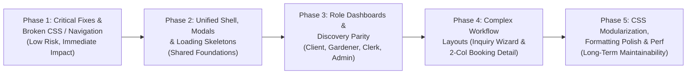

# HugaTiera — Phased UI/UX Implementation Roadmap

**Audit Date:** November 25, 2026  
**Status:** **Proposal Only — Awaiting User Approval Before Any Code Edits**

This roadmap sequences every finding from [recommended-changes.md](file:///c:/xampp/htdocs/HugaTiera/docs/ui-ux/recommended-changes.md) by **severity, dependency order, and regression risk** so each phase can be implemented, tested (`eslint`, `vite build`, and automated backend/browser checks), and committed cleanly without destabilizing working features.

---

## Dependency & Sequencing Overview

---

## Phase 1 — Critical Accessibility, CSS & Functional Bug Fixes *(Recommended First Phase)*

**Goal:** Eliminate every confirmed broken link, invisible button, unstyled list, and inaccurate metric in a tight, zero-regression pass.

| Included Items | Target Files | Complexity | Regression Risk |
|---|---|---|---|
| **CRIT-01:** High-contrast `.app-sidebar-switch-role` + collapsed icon rail styling | `frontend/src/App.css` | Small | Very Low |
| **CRIT-02:** Fix Clerk `/notifications` ("Open messages" hidden for Clerk; booking/payment notifications route to `/dashboard?tab=payments`) | `frontend/src/pages/CommunicationPage.jsx` | Small | Very Low |
| **CRIT-03:** Fix undefined `.dashboard-stats`, `.weekday-picker`, `.weekday-chip` on `ClerkDashboard` (reuse `.stat-grid`/`.stat-card` and `.weekday-toggle-grid`/`.weekday-pill`) + update outdated empty-state copy (**MED-05a**) | `frontend/src/components/ClerkDashboard.jsx` | Small | Very Low |
| **CRIT-04:** Fix Admin Analytics `activeBookings` status check (`'confirmed'` → `'accepted'`) | `frontend/src/pages/DashboardPage.jsx` | Trivial | Very Low |
| **CRIT-05:** Fix `.manage-list` → `.managed-list`, `.manage-item` → `.managed-item`, and `.status-badge` → `inquiry-status` in Admin Dashboard | `frontend/src/pages/DashboardPage.jsx` | Trivial | Very Low |
| **HIGH-03 & HIGH-04:** Fix tablet `.marketplace-card:last-child { grid-column: span 2 }` bug and mobile `.inquiry-detail-grid` reverse-order bug | `frontend/src/App.css` | Trivial | Low |
| **MED-07:** Fix `@media print` selectors to hide `.ai-chat-dock, .ai-chat-window, .ai-chat-fab` | `frontend/src/App.css` | Trivial | Very Low |

- **Estimated Effort:** ~1–2 hours.
- **Verification Gate:** `npm --prefix frontend run lint`, `npm --prefix frontend run build`, live visual inspection across Client, Gardener (Dual-Role expanded & collapsed sidebar), Clerk (`/dashboard` & `/notifications`), and Admin (`Overview`, `Analytics`, `Pricing`) at desktop (`1280px`), tablet (`820px`), and mobile (`390px`).

---

## Phase 2 — Shared UI Foundations (Navigation Sync, Shared Modal & Loading States)

**Goal:** Build shared primitives before touching heavier workflow screens so Phases 3 and 4 reuse consistent patterns instead of duplicating code.

| Included Items | Target Files | Complexity | Regression Risk |
|---|---|---|---|
| **HIGH-01:** Add initial `loading` skeleton states to `DashboardPage` (eliminates approved-gardener red banner flash & `0` flash) and `BookingList` (eliminates empty-state flash) | `frontend/src/pages/DashboardPage.jsx`, `frontend/src/pages/BookingPage.jsx` | Small | Low |
| **HIGH-02:** Live sidebar unread badge refresh on route change / custom event; add Gardener sidebar links (`My services`, `Portfolio`, `My Clerks`, `Marketplace`); map missing `Pricing` / `Portfolio` / `My Clerks` icons; remove duplicated desktop top tabs where sidebar already owns navigation | `frontend/src/components/AppSidebar.jsx`, `frontend/src/services/profiles.js`, `frontend/src/pages/CommunicationPage.jsx`, `frontend/src/pages/DashboardPage.jsx`, `frontend/src/components/ClerkDashboard.jsx` | Medium | Medium *(verify active tab states across all 4 roles)* |
| **HIGH-08:** Extract shared `<ConfirmModal />` component; replace Admin Gardener Approval `window.confirm` / `window.prompt`; add delete/deactivate confirmations + **Reactivate** toggle in Gardener `GardenerTools`; unify Clerk payment rejection modal (**MED-05b**) | `frontend/src/components/ConfirmModal.jsx` *(new)*, `frontend/src/pages/DashboardPage.jsx`, `frontend/src/components/ClerkDashboard.jsx`, `frontend/src/components/GardenerClerksPanel.jsx`, `frontend/src/pages/BookingPage.jsx` | Medium | Low |
| **MED-09 & LOW-03:** Support `?next=` post-login redirect on `ProtectedRoute` + `LoginPage`, and expose `refreshUser()` on `AuthContext` so sidebar name updates immediately on profile save | `frontend/src/context/AuthContext.jsx`, `frontend/src/components/ProtectedRoute.jsx`, `frontend/src/pages/AuthPage.jsx`, `frontend/src/pages/DashboardPage.jsx` | Small | Low |

- **Estimated Effort:** ~3–4 hours.
- **Verification Gate:** Frontend lint & build; verify all 4 roles' navigation links, active states, badge clearing after reading notifications, modal Escape/backdrop dismiss, and post-login redirect safety (relative URL guard).

---

## Phase 3 — Role Dashboards, Public Discovery Parity & Admin Usability

**Goal:** Close functional UI gaps across Discovery, Gardener Overview, Admin Accounts/Reports/Notifications, and Clerk Profile.

| Included Items | Target Files | Complexity | Regression Risk |
|---|---|---|---|
| **HIGH-07:** Add Search, Role filter pills, Status filter, pagination, and responsive mobile stacked table cards to Admin `Accounts` (and Clerk `Recent bookings` table) | `frontend/src/pages/DashboardPage.jsx`, `frontend/src/components/ClerkDashboard.jsx`, `frontend/src/App.css` | Medium | Low |
| **MED-01 & LOW-02:** Display `service.image_path` cover hero & rating on `ServiceDetailPage`, display `avatar_path` + `.visual-market-card` grid on `GardenerPage`, replace rotated `ArrowLeft` with `ArrowRight` | `frontend/src/pages/ServiceDetailPage.jsx`, `frontend/src/pages/GardenerPage.jsx`, `frontend/src/App.css` | Small–Medium | Low |
| **MED-02 & MED-03:** Add live Service Category dropdown to Gardener's `GardenerOpportunityShowcase` and add compact **Earnings & Payments Snapshot** on Gardener Overview | `frontend/src/pages/DashboardPage.jsx` | Small | Low |
| **MED-04:** Add `resolutionNotes` input + save action in Admin `Reports`, and enable `/notifications` for Administrators | `frontend/src/App.jsx`, `frontend/src/services/profiles.js`, `frontend/src/pages/DashboardPage.jsx` | Small | Low |
| **MED-05c:** Enable simplified `/profile` view for `clerk` users (name, phone, avatar) | `frontend/src/App.jsx`, `frontend/src/pages/DashboardPage.jsx` | Small | Low |
| **MED-06 & MED-08:** Fix `AssistantPage` back link (`/dashboard`), add safe markdown formatting for Gemini plans, add auto-scroll & search on `/messages`, add status filter pills to `InquiryList`, and trim repetitive CTA blocks on Dashboard Overview | `frontend/src/pages/AssistantPage.jsx`, `frontend/src/pages/CommunicationPage.jsx`, `frontend/src/pages/InquiryPage.jsx`, `frontend/src/pages/DashboardPage.jsx` | Medium | Low |
| **LOW-04 & LOW-06:** Compact mobile dots in `GardenerScheduleCalendar` (`<= 560px`) + `ZAMBOANGA_BARANGAYS` datalist autocomplete on area filters | `frontend/src/components/GardenerScheduleCalendar.jsx`, `frontend/src/pages/ServicesPage.jsx`, `frontend/src/pages/DashboardPage.jsx` | Small | Very Low |

- **Estimated Effort:** ~4–6 hours.
- **Verification Gate:** Frontend lint & build; verify backend `integration.test.js` (`TC-17`/`TC-18` role/route guards!) still passes 100%, especially after any route changes in `App.jsx` or `profiles.js`.

---

## Phase 4 — High-Density Workflow Redesigns (Inquiry Creation Wizard & 2-Column Booking Detail)

**Goal:** Reduce cognitive load and heavy vertical scrolling on the two most complex pages in HugaTiera.

| Included Items | Target Files | Complexity | Regression Risk |
|---|---|---|---|
| **HIGH-05:** Guard `/inquiries/new` for Client role cleanly and convert `InquiryForm` into a guided **3-step wizard** (`1. Scope & Specs` → `2. Size, Add-ons & Live Estimate` → `3. Photos, AI Helper & Submit`) reusing `/register`'s stepper pattern | `frontend/src/App.jsx`, `frontend/src/pages/InquiryPage.jsx`, `frontend/src/App.css` | Large | Medium *(preserve all Case 1/Case 2 payload fields, photo attachment, and AI autofill)* |
| **HIGH-06:** Restructure `BookingDetails` into a 2-column desktop layout (main action/payment/closure flow left + sticky schedule/agreement/actions rail right) while keeping mobile stacked cleanly | `frontend/src/pages/BookingPage.jsx`, `frontend/src/App.css` | Medium–Large | Medium *(preserve online PayMongo/Sandbox callbacks, receipt upload, reschedule, and print styles)* |

- **Estimated Effort:** ~5–7 hours.
- **Verification Gate:** Full end-to-end manual walkthrough of Case 1 General Request, Case 2 Direct Inquiry, Mutual Agreement approval, Sandbox Checkout + Manual Receipt verification, Reschedule, Closing Agreement, and Review submission, plus `npm --prefix frontend run lint` & `build`.

---

## Phase 5 — Performance Optimization, Currency Standardization & CSS Modularization

**Goal:** Eliminate N+1 frontend image waterfalls, standardize formatting, and split monolithic `App.css` for long-term team scalability.

| Included Items | Target Files | Complexity | Regression Risk |
|---|---|---|---|
| **HIGH-09:** Debounce `/services` filter inputs (`220ms`), add card skeletons + `"Clear filters"`, and *(if backend change approved)* return `first_portfolio_id` / `first_image_id` from list SQL queries to remove N+1 fan-out on `/services`, `/inquiries`, and `/bookings` | `frontend/src/pages/ServicesPage.jsx`, `InquiryPage.jsx`, `BookingPage.jsx` (+ optional `backend/controllers/service.controller.js`, `inquiry.controller.js`, `booking.controller.js`) | Medium | Low–Medium |
| **LOW-01 & LOW-05:** Shared `formatCurrency()` utility across all financial displays + replace inline `style={{ ... }}` in `InquiryDetails` with CSS classes | `frontend/src/utils/formatters.js` *(new)* + pages | Small | Very Low |
| **MED-10:** Split 5,439-line `App.css` into domain stylesheets (`base`, `sidebar`, `auth`, `marketplace`, `dashboard`, `bookings`, `modals`) consolidated to 4 canonical breakpoints (`1100px`, `900px`, `760px`, `560px`) | `frontend/src/styles/*.css` *(new)*, `frontend/src/App.jsx` | Large | Medium *(requires visual regression sweep across every route)* |

- **Estimated Effort:** ~5–8 hours.
- **Verification Gate:** Full visual verification across every route at `1440px`, `1024px`, `768px`, and `390px`; all `15` backend test suites (`80/80` tests) + `eslint` + `vite build`.

---

## Overall Complexity & Recommendation Summary

| Metric | Assessment |
|---|---|
| **Estimated Total Effort (Phases 1–5)** | ~18–27 focused developer hours (easily split across teammates after Phase 2) |
| **Highest-ROI Immediate Step** | **Start with Phase 1 (~1–2 hours):** Fixes all 5 Critical bugs (invisible Dual-Role switcher, broken Clerk notification links, unstyled Clerk/Admin Pricing widgets, wrong Admin Analytics active-booking count), tablet grid gaps, mobile inquiry reverse-order, and print CSS overlap with minimal regression risk. |
| **Optional Mobbin Research Follow-Up** | If you upgrade Mobbin or share screenshots/URLs from Mobbin web, run visual reference comparisons right before **Phase 4** (Inquiry 3-step wizard & Booking 2-column redesign) where visual layout decisions have the highest payoff. |
